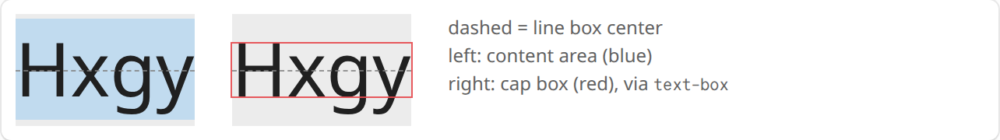
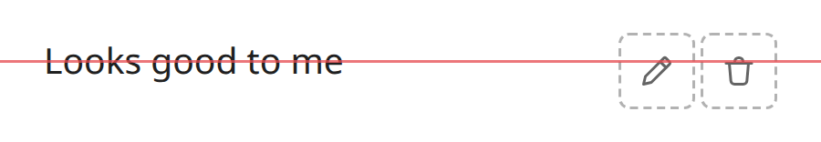
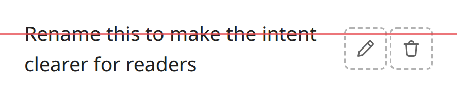
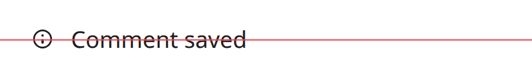
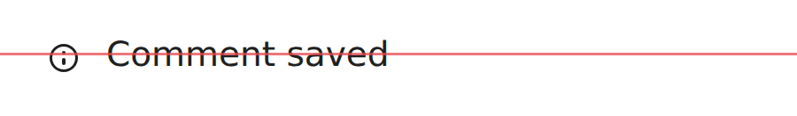

# Why it's hard

The [cover](README.md) states the problem. This page shows where each pixel of error comes from.

## Three boxes, three centers

- **Line box** (`line-height`): what flex and grid center on.
- **Content area** (font ascent + descent): the line box minus half-leading, which is split evenly above and below.
- **Cap box** (cap height down to baseline): what the eye centers on.
- The three centers differ by font. Descender and accent space make the content area lopsided around the caps.

Live in the local viewer, in your browser's font: gray = line box, blue = content area, red outline = cap box.

```html
<style>
.ita-anat{display:flex;gap:24px;align-items:flex-start;font:48px/72px ui-sans-serif,-apple-system,BlinkMacSystemFont,"Segoe UI",Helvetica,Arial,sans-serif}
.ita-anat-line{background:rgba(127,127,127,.15);position:relative}
.ita-anat-content{background:rgba(0,144,255,.18)}
.ita-anat-cap{display:inline-block;outline:1.5px solid rgba(229,72,77,.9);text-box:trim-both cap alphabetic}
.ita-anat-mid{position:absolute;left:0;right:0;top:50%;border-top:1px dashed rgba(127,127,127,.8)}
.ita-anat-key{font-size:12px;line-height:18px;opacity:.7}
</style>
<div class="ita-anat">
  <div class="ita-anat-line"><span class="ita-anat-content">Hxgy</span><span class="ita-anat-mid"></span></div>
  <div class="ita-anat-line"><span class="ita-anat-cap">Hxgy</span><span class="ita-anat-mid"></span></div>
  <div class="ita-anat-key">dashed = line box center<br>left: content area (blue)<br>right: cap box (red), via <code>text-box</code></div>
</div>
```

The hosted viewer can't run the live demo. Captured in Chromium with Noto Sans:



## Cause 1: boxes taller than one line (the big one)

- Quiet icon button: `controlSize.height` = 28px. `sm` line: 20px.
- **Top-aligned row:** the button overhangs the line by 8px, so the icon sits **4px low**.
- **Centered row:** fine for one line. With two lines the button centers on the paragraph, **10px** off line 1.
- diffmap's comment card hit both. The fix had to target `[data-button-content]`, an internal Button wrapper.

:::gallery side-by-side


:::

Red line = middle of the capitals. Dashed = button box. Real Maui `Button variant="quiet"` + `Text size="sm"`.

## Cause 2: font metrics

- In a centered row the icon centers on the **line box**, and the caps aren't at its center.
- Measured with `Information size` matching `Text size`, icon center minus cap center (+ = icon low):

| Font | `sm` | `xl` |
| --- | --- | --- |
| Noto Sans | 0px | 0px |
| Liberation Sans (Arial metrics) | 0.5px | 1px |
| DejaVu Sans | 2px | 2.5px |

- The error grows with size, and Maui's stack falls back across fonts, so no single offset fits every font.
- Maui hit this before: the Avatar commit `87c8b5a` measured caps "up to 1.4px high".

:::gallery side-by-side


:::

## Cause 3: icon positioning tricks are approximations

- `vertical-align: middle` centers on baseline + ½ x-height, which is below cap center, so icons sink.
- `vertical-align: text-bottom` (Primer's default) and `1em` boxes (MUI, Chakra) depend on the content area, which is font-dependent.
- See the [live comparison](02-other-design-systems.md#vertical-align-and-1em-icons-mui-chakra-primer).

## Cause 4: trimming changes size

- `text-box: trim-both cap alphabetic` makes the box exactly cap-tall. Great for centering, but a row of trimmed text loses its line rhythm.
- Button's label trim forced the 8 → 9px spacing step (`5f4b02a`). `TabBar` has to undo it (`textBox: normal`).
- Fix: pad back `(1lh - 1cap) / 2` on each side. See [`capCenter`](03-text-cap-center.md).

## Maui history: five ad-hoc fixes

| Where | Trick |
| --- | --- |
| Button label `[[src/components/Button.tsx#L103-L107]]` | `textBox` trim, spacing retuned |
| Avatar initials `[[src/components/Avatar.tsx#L92-L98]]` | `textBox` trim on inner block |
| Calendar mini day `[[src/apps/Calendar/Calendar.tsx#L1465-L1476]]` | `textBox` trim on grid cell |
| Banner icon `[[src/components/Banner.tsx#L59-L74]]` | icon box `1lh`, inset `(controlHeight − 1lh) / 2` |
| diffmap `CommentCard` (PR #56) | buttons `1lh`, text trimmed + padded `(1lh − 1cap) / 2` |

Measurements: Playwright on Chromium (Linux, 3× scale), with icon glyph `getBBox()` center vs baseline − ½ cap height of `H`.
