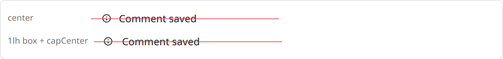
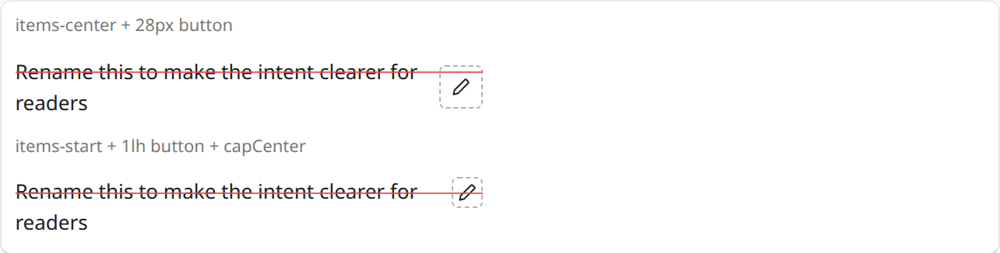
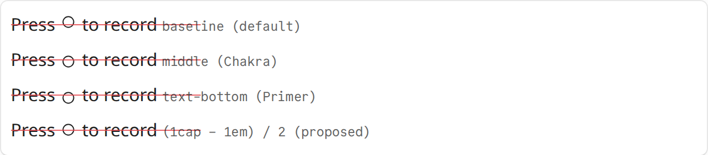

# Other design systems

[Why it's hard](01-why-its-hard.md) named the causes: boxes taller than a line, font metrics, and approximate icon tricks. This page shows how other systems handle each one.

- **Live demos** run in the local viewer (`npx product-doc serve`) in your browser's font. diffmap.dev shows a Chromium capture instead.
- The red line marks the middle of the capitals. It needs CSS `text-box`, so it's off in browsers without it.
- Snippets are trimmed to the alignment part.

## At a glance

| System | Boxes vs one line | Font metrics | Inline icons |
| --- | --- | --- | --- |
| Radix Themes | Ghost buttons use negative margin | `trim` prop with per-font vars | — |
| Capsize | — | Computes cap box from metrics | — |
| CSS `text-box` | — | Native cap box | — |
| Tailwind UI | Icon box = `leading` (`h-6` / `leading-6`) | — | — |
| Spectrum | `top-to-icon` / `top-to-control` tokens | Baked into tokens | — |
| Primer | Visual slots in Button | — | `verticalAlign` prop |
| MUI / Chakra | `edge` negative margins (MUI) | — | `1em` + `vertical-align` |
| Atlassian | Icon `spacing` pads glyph to box | — | — |
| Polaris | Fixed offsets on checkbox/choice | — | — |
| Apple SF Symbols | First-baseline stacks | Symbols are glyphs | Centered on cap height |
| **Maui (proposed)** | `1lh` boxes | `capCenter` (`text-box` + `1cap`) | `Icon inline` (later) |

## Radix Themes: `trim`

- `<Text trim="both">` removes leading above caps and below the baseline, using negative margins from per-font CSS vars.
- Used for flush edges (heading against card padding), not for centering beside icons.
- Ghost buttons and IconButtons get negative margins so the glyph, not the hover fill, lines up with text.

```tsx
<Card>
  <Heading trim="start">Billing</Heading>
  <Text as="p" trim="end">Update your plan.</Text>
</Card>
<IconButton variant="ghost"><Pencil1Icon /></IconButton>
// [!note trim] start | end | both | normal; uses --heading-leading-trim-start etc.
// [!note ghost] Negative margin equal to padding, so the icon aligns with the text column.
```

## Capsize: metrics in, cap box out

- Pass font metrics, get styles whose box is exactly cap-tall. Spacing then measures from the caps.
- Needs metrics for every font. A fallback font gets the wrong trim.

```ts
import { createStyleObject } from "@capsizecss/core"
import metrics from "@capsizecss/metrics/inter"

createStyleObject({ fontSize: 13, leading: 20, fontMetrics: metrics })
// → { fontSize, lineHeight, "::before": { marginBottom: … }, "::after": { marginTop: … } }
// [!note createStyleObject] Negative margins on pseudo-elements cancel the space above the caps and below the baseline.
```

## CSS `text-box`: Capsize built in

- `text-box: trim-both cap alphabetic` trims to cap top and baseline, using the **rendered** font's metrics, so fallbacks work too.
- Pair it with `1cap` / `1lh` units to pad back to whole lines. This is Maui's [`capCenter`](03-text-cap-center.md).
- Support: Chrome 133+, Safari 18.2+. Check Firefox before relying on it, and wrap in `@supports`.

Live: a centered row (today's default) vs cap-centered text + a `1lh` icon box (proposed):

```html
<style>
.ita-demo{display:grid;gap:10px;font:13px/20px ui-sans-serif,-apple-system,BlinkMacSystemFont,"Segoe UI",Helvetica,Arial,sans-serif;overflow:hidden;padding:4px 0}
.ita-row{display:flex;gap:8px;align-items:center;width:340px}
.ita-start{align-items:flex-start}
.ita-tag{font-size:11px;line-height:14px;opacity:.6;width:110px;flex:none;align-self:center}
.ita-cap{display:inline-block;width:0;color:transparent;position:relative;text-box:trim-both cap alphabetic}
.ita-cap::after{content:"";position:absolute;top:50%;left:-36px;width:240px;border-top:1px solid rgba(229,72,77,.85)}
.ita-ico{width:16px;height:16px;flex:none}
.ita-box{width:1lh;height:1lh;display:grid;place-items:center;flex:none}
.ita-cc{display:block}
@supports (text-box: trim-both cap alphabetic){.ita-cc{text-box:trim-both cap alphabetic;padding-block:calc((1lh - 1cap) / 2)}}
</style>
<div class="ita-demo">
  <div class="ita-row"><span class="ita-tag">center</span>
    <svg class="ita-ico" viewBox="0 0 24 24" fill="none" stroke="currentColor" stroke-width="1.5"><path d="M12 13V15" stroke-width="2" stroke-linecap="round"/><circle cx="12" cy="9" r="1" fill="currentColor" stroke="none"/><circle cx="12" cy="12" r="7.25"/></svg>
    <span><span class="ita-cap">H</span>Comment saved</span></div>
  <div class="ita-row ita-start"><span class="ita-tag">1lh box + capCenter</span>
    <span class="ita-box"><svg class="ita-ico" viewBox="0 0 24 24" fill="none" stroke="currentColor" stroke-width="1.5"><path d="M12 13V15" stroke-width="2" stroke-linecap="round"/><circle cx="12" cy="9" r="1" fill="currentColor" stroke="none"/><circle cx="12" cy="12" r="7.25"/></svg></span>
    <span class="ita-cc"><span class="ita-cap">H</span>Comment saved</span></div>
</div>
```

The hosted viewer can't run the live demo. Captured in Chromium with Noto Sans:



```css
.text {
  @supports (text-box: trim-both cap alphabetic) {
    text-box: trim-both cap alphabetic;
    padding-block: calc((1lh - 1cap) / 2);
  }
}
```

## Tailwind UI: icon box as tall as the line

- No trim utility. Rows use `items-start`, and the icon box matches the line height (`h-6` next to `leading-6`), so the icon stays on line 1 when text wraps.
- Same idea as Maui's Banner icon (`1lh`). `h-[1lh]` works as an arbitrary value.

```jsx
<div class="flex items-start gap-x-3">
  <div class="flex h-6 w-5 flex-none items-center"><CheckIcon class="size-5" /></div>
  <p class="text-sm/6">Wraps onto a second line…</p>
</div>
```

Live, with two lines:

```html
<style>
.ita-tw{display:grid;gap:12px;font:13px/20px ui-sans-serif,-apple-system,BlinkMacSystemFont,"Segoe UI",Helvetica,Arial,sans-serif;overflow:hidden}
.ita-tw-row{display:flex;gap:8px;align-items:center;width:300px}
.ita-tw-start{align-items:flex-start}
.ita-tw-btn{width:28px;height:28px;display:grid;place-items:center;border:1px dashed rgba(127,127,127,.6);border-radius:4px;box-sizing:border-box;flex:none}
.ita-tw-line{width:1lh;height:1lh}
.ita-tw-tag{font-size:11px;line-height:14px;opacity:.6}
.ita-tw-cap{display:inline-block;width:0;color:transparent;position:relative;text-box:trim-both cap alphabetic}
.ita-tw-cap::after{content:"";position:absolute;top:50%;left:0;width:300px;border-top:1px solid rgba(229,72,77,.85)}
.ita-tw-cc{display:block;flex:1}
@supports (text-box: trim-both cap alphabetic){.ita-tw-cc{text-box:trim-both cap alphabetic;padding-block:calc((1lh - 1cap) / 2)}}
</style>
<div class="ita-tw">
  <div class="ita-tw-tag">items-center + 28px button</div>
  <div class="ita-tw-row"><span style="flex:1"><span class="ita-tw-cap">H</span>Rename this to make the intent clearer for readers</span>
    <span class="ita-tw-btn"><svg width="16" height="16" viewBox="0 0 24 24" fill="none" stroke="currentColor" stroke-width="1.5" stroke-linejoin="round"><path d="M4.75 19.25L9 18.25L18.95 8.3C19.34 7.91 19.34 7.28 18.95 6.89L17.11 5.05C16.72 4.66 16.09 4.66 15.7 5.05L5.75 15L4.75 19.25Z"/></svg></span></div>
  <div class="ita-tw-tag">items-start + 1lh button + capCenter</div>
  <div class="ita-tw-row ita-tw-start"><span class="ita-tw-cc"><span class="ita-tw-cap">H</span>Rename this to make the intent clearer for readers</span>
    <span class="ita-tw-btn ita-tw-line"><svg width="16" height="16" viewBox="0 0 24 24" fill="none" stroke="currentColor" stroke-width="1.5" stroke-linejoin="round"><path d="M4.75 19.25L9 18.25L18.95 8.3C19.34 7.91 19.34 7.28 18.95 6.89L17.11 5.05C16.72 4.66 16.09 4.66 15.7 5.05L5.75 15L4.75 19.25Z"/></svg></span></div>
</div>
```

The hosted viewer can't run the live demo. Captured in Chromium with Noto Sans:



## Adobe Spectrum: offset tokens

- Each control publishes how far its text and icon sit from its top edge, per size.
- Checkboxes and radios use `*-top-to-control` so the box lands on line 1 of a wrapping label.
- Works, but it's a table of numbers per control × size that drifts when fonts change.

```css
.spectrum-Checkbox-box {
  margin-block-start: var(--spectrum-checkbox-top-to-control-medium);
}
.spectrum-ActionButton-icon {
  margin-block-start: var(--spectrum-component-top-to-workflow-icon-100);
}
```

## Vertical-align and `1em` icons: MUI, Chakra, Primer

- **MUI** `SvgIcon`: `font-size: inherit` → `1em` box. Docs say to wrap in `display: flex; align-items: center`. `IconButton edge="start"` adds a negative margin for optical edges.
- **Chakra** `Icon`: `inline-block; line-height: 1em; vertical-align: middle`.
- **Primer** Octicons: `verticalAlign` prop, default `text-bottom`. Button `leadingVisual` / `trailingVisual` slots own the layout.
- All three approximate the cap center. Live, a 1em icon inline in a sentence:

```html
<style>
.ita-va{display:grid;gap:6px;font:16px/24px ui-sans-serif,-apple-system,BlinkMacSystemFont,"Segoe UI",Helvetica,Arial,sans-serif;overflow:hidden}
.ita-va-row{position:relative;width:420px}
.ita-va svg{width:1em;height:1em}
.ita-va-cap{display:inline-block;width:0;color:transparent;position:relative;text-box:trim-both cap alphabetic}
.ita-va-cap::after{content:"";position:absolute;top:50%;left:0;width:172px;border-top:1px solid rgba(229,72,77,.85)}
.ita-va code{font-size:12px;opacity:.7}
</style>
<div class="ita-va">
  <div class="ita-va-row"><span class="ita-va-cap">H</span>Press <svg viewBox="0 0 24 24" fill="none" stroke="currentColor" stroke-width="1.5"><circle cx="12" cy="12" r="7.25"/></svg> to record <code>baseline (default)</code></div>
  <div class="ita-va-row"><span class="ita-va-cap">H</span>Press <svg style="vertical-align:middle" viewBox="0 0 24 24" fill="none" stroke="currentColor" stroke-width="1.5"><circle cx="12" cy="12" r="7.25"/></svg> to record <code>middle (Chakra)</code></div>
  <div class="ita-va-row"><span class="ita-va-cap">H</span>Press <svg style="vertical-align:text-bottom" viewBox="0 0 24 24" fill="none" stroke="currentColor" stroke-width="1.5"><circle cx="12" cy="12" r="7.25"/></svg> to record <code>text-bottom (Primer)</code></div>
  <div class="ita-va-row"><span class="ita-va-cap">H</span>Press <svg style="vertical-align:calc((1cap - 1em) / 2)" viewBox="0 0 24 24" fill="none" stroke="currentColor" stroke-width="1.5"><circle cx="12" cy="12" r="7.25"/></svg> to record <code>(1cap − 1em) / 2 (proposed)</code></div>
</div>
```

The hosted viewer can't run the live demo. Captured in Chromium with Noto Sans:



## Atlassian and Polaris: box conventions

- **Atlassian** icons take `spacing="none | compact | spacious"`, which pads the glyph so it fills a standard box (16 → 24px). Alignment comes from boxes matching control heights.
- **Polaris** uses `InlineStack blockAlign="center"`, and hard-codes the offset that puts checkbox and choice controls on line 1.

```tsx
<Icon glyph={EditIcon} label="" spacing="spacious" />   // Atlassian
<InlineStack gap="200" blockAlign="center">…</InlineStack> // Polaris
```

## Apple SF Symbols: icons are glyphs

- Symbols ship inside the font system. They sit on the baseline, center on cap height, and scale with text size and weight.
- Stacks align on the first baseline, so a symbol stays on line 1 of wrapping text.
- This is the target: alignment comes from typography, not box math. On the web, `capCenter` + `1lh` boxes get closest.

```swift
HStack(alignment: .firstTextBaseline) {
  Image(systemName: "pencil")
  Text("Rename this to make the intent clearer")
}
.font(.body)
.imageScale(.medium)
```

## Takeaways for Maui

- Use **native `text-box` + `1cap`**: Capsize's result with no metric tables, and it handles fallback fonts.
- Use **`1lh` boxes**: the Tailwind UI and Banner pattern, which fixes the 4–10px box error.
- Skip Spectrum-style offset tokens: `1lh` / `1cap` make them unnecessary.
- Keep Radix-style edge `trim` as a possible later option.
