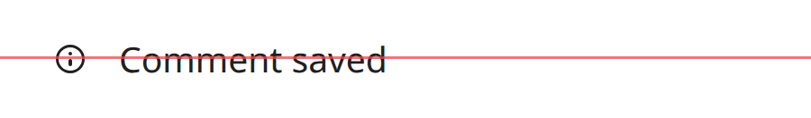
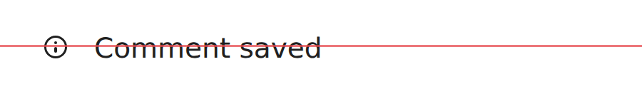

# Cap-centered text: text({ capCenter })

[Why it's hard](01-why-its-hard.md#cause-2-font-metrics) showed that the caps aren't centered in the line box, and the offset depends on the font. This phase adds one option to `[[src/tokens/text.ts#text]]` that fixes it.

**Today**

- `text()` sets size, weight and color. It has no trim.
- Every component that needs centered caps copies `textBox: "trim-both cap alphabetic"` and retunes padding.

**Proposed**

- `text({ size: "sm", capCenter: true })` keeps every line `1lh` tall, and the caps sit in the middle of each line.
- An icon in a `1lh` box beside it lines up with no extra CSS.

```ts {9-15} [src/tokens/text.ts (illustrative)]
export type TextOptions = {
  // ...
  /** Center capitals in each line box. Needs a block box. */
  capCenter?: boolean
}

export const text = memoize((options: TextOptions = {}) => style({
  // ...
  ...(options.capCenter && {
    display: "block",
    "@supports (text-box: trim-both cap alphabetic)": {
      textBox: "trim-both cap alphabetic",
      paddingBlock: "calc((1lh - 1cap) / 2)",
    },
  }),
}))
// [!note L11-L13] Trim to the caps, then pad back the same amount on both sides, so the box is n × 1lh again with the caps centered.
// [!note L10] Without text-box, the padding would add height, so both lines sit behind the guard.
```

- `Text` gets the same `capCenter` prop.
- Alternative name: `trim: "cap-center"`, which leaves room for Radix-style `trim: "start" | "end" | "both"` later.

## Measured

`1lh` icon box + `capCenter` text. The scratch page applied this CSS to real Maui `Text`:

:::gallery side-by-side


:::

## Tradeoffs

- ✅ No layout change: n lines still take n × `1lh`.
- ✅ Font-independent: the trim uses the rendered font's metrics.
- ⚠️ Browsers without `text-box` keep today's offset (0–2.5px), never worse.
- ⚠️ Needs a block box. Inline `Text` inside a sentence ignores it.

## Verify

- Unit: `text({ capCenter: true })` emits the guarded rules.
- [the alignment check](07-alignment-check.md) measures ≤ 0.5px at every size.

```changes

```
