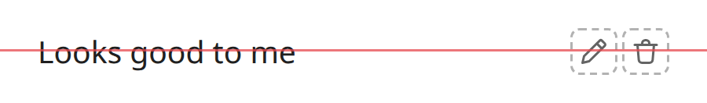
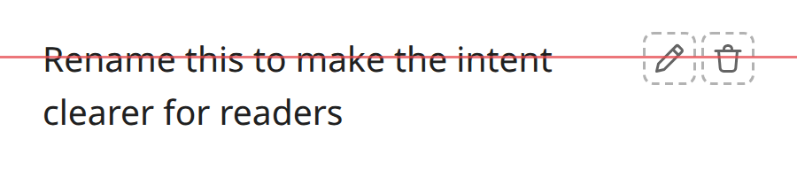

# One-line icon buttons: Button size="line"

[Why it's hard](01-why-its-hard.md#cause-1-boxes-taller-than-one-line-the-big-one) showed the biggest error: 28px buttons beside 20px lines. [`capCenter`](03-text-cap-center.md) centers the caps in each line. This phase makes an icon button exactly one line tall.

**Today**

- `size` is `"default"` (28px) or `"sm"` (24px). Both are taller than a line of `xs`–`lg` text.
- diffmap had to write `& > button:has([data-button-content] > svg:only-child) { height: 100% }`, which depends on Button internals.

**Proposed**

- `<Button size="line" variant="quiet">` is `1lh` square, using the parent's `font-size` / `line-height`.
- Put it beside `capCenter` text in an `alignItems: start` row. It stays on line 1 when the text wraps.

```tsx [diffmap CommentCard, after (illustrative)]
<div className={row /* flex, alignItems: start */}>
  <Text size="sm" capCenter>{comment.body}</Text>
  <Button size="line" variant="quiet" aria-label="Edit"><Pencil size="sm" /></Button>
  <Button size="line" variant="quiet" aria-label="Delete"><Trash size="sm" /></Button>
</div>
```

```ts [src/components/Button.tsx (illustrative)]
const lineButtonClass = style({
  font: "inherit",
  height: "1lh",
  aspectRatio: "1",
  minWidth: 0,
  padding: 0,
  position: "relative",
  "&::before": { content: '""', position: "absolute", inset: "-4px" },
})
// [!note font] Inherit size so 1lh matches the neighbouring text, not Button's xs.
// [!note L8] Bigger hit area without changing layout.
```

## Measured

Real Maui quiet `Button`s set to `height: 1lh; aspect-ratio: 1; padding: 0`, beside `capCenter` text:

:::gallery side-by-side


:::

## Tradeoffs

- ✅ Fixes the 4–10px error where it starts. Apps write no `[data-button-content]` selectors.
- ⚠️ The visual target is small (20px at `sm`). Allow only `quiet` and `text` variants, and expand the hit area.
- ⚠️ Hover fill is line-tall, which reads as tight. Radix-style negative margin is the other option: keep 28px and pull it back with `margin-block: calc((1lh - 28px) / 2)`. That keeps the target size, but the fill overlaps neighbouring lines.

## Verify

- Gallery row for every text size × `quiet` / `text`.
- [the alignment check](07-alignment-check.md) check ≤ 0.5px.
- Keyboard focus ring visible, not clipped.

```changes

```
