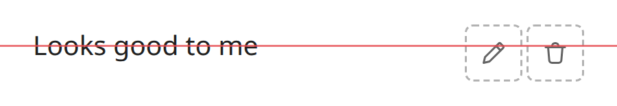
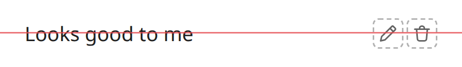

# Line up icons and icon buttons with text

**Status: proposal. Nothing is built.** The screenshots show real Maui components. The "Proposed" captures apply the proposed CSS by hand in a scratch page.

## Problem

- An icon or icon button beside text often sits off the text's capitals.
- Maui's quiet icon button is **28px**. One line of `sm` text is **20px**. In a top-aligned row the icon sits **4px low**.
- In a centered row with two lines of text, the button drifts to the middle of the paragraph (**10px** off line 1).
- The font adds more. In a centered icon + text row, the offset measured **0px** with Noto Sans and **2px** with DejaVu Sans.
- Maui has fixed this five times, each fix ad hoc. `text()` has no option for it.

:::gallery side-by-side

:::

The red line marks the middle of the capitals. Dashed boxes show the button size.

## Solution

- **One rule:** in an icon + text row, use `alignItems: start`, make every box `1lh` tall, and cap-center the text.
- **Three small APIs** carry the rule:
  - [`text({ capCenter: true })`](03-text-cap-center.md): the caps sit in the middle of each line box.
  - [`Button size="line"`](04-button-line-size.md): an icon button exactly one line tall.
  - [`iconStyles.lineBox`](05-icon-line-box.md): a `1lh` square that centers an icon.
- Then [migrate the five existing fixes](06-migrate-existing-fixes.md) and [add a measured check](07-alignment-check.md).
- [Inline icons in running text](08-inline-icons.md) can come later.

## Goals

- Icon center within **0.5px** of cap center, at every text size, in any font.
- Apps need no `[data-button-content]` selectors and no `calc()`.
- No layout shift: rows keep whole-line heights.

## Non-goals

- Radix-style `trim` that removes leading at card edges (heading flush with padding). It's a separate problem, and `capCenter` leaves room for it.
- Redrawing icons or changing the icon size scale.
- Per-font metric tables (Capsize). CSS `text-box` and `1cap` replace them.

## Pages

1. [Why it's hard](01-why-its-hard.md): causes, measurements, Maui history.
2. [Other design systems](02-other-design-systems.md): how Radix, Capsize, Tailwind, Spectrum, SF Symbols and others solve it.
3. [`text({ capCenter })`](03-text-cap-center.md)
4. [`Button size="line"`](04-button-line-size.md)
5. [`iconStyles.lineBox`](05-icon-line-box.md)
6. [Migrate existing fixes](06-migrate-existing-fixes.md)
7. [Alignment gallery and check](07-alignment-check.md)
8. [Inline icons (later)](08-inline-icons.md)

## References

- diffmap [PR #56](https://github.com/tanishqkancharla/diffmap/pull/56): the `CommentCard` fix that started this.
- `[[src/tokens/text.ts#text]]`, `[[src/components/Button.tsx#buttonStyles]]`, `[[src/components/Banner.tsx#L64-L74]]`
- [CSS `text-box` (MDN)](https://developer.mozilla.org/en-US/docs/Web/CSS/text-box), [Capsize](https://seek-oss.github.io/capsize/), [Radix Themes Text `trim`](https://www.radix-ui.com/themes/docs/components/text#trim)
