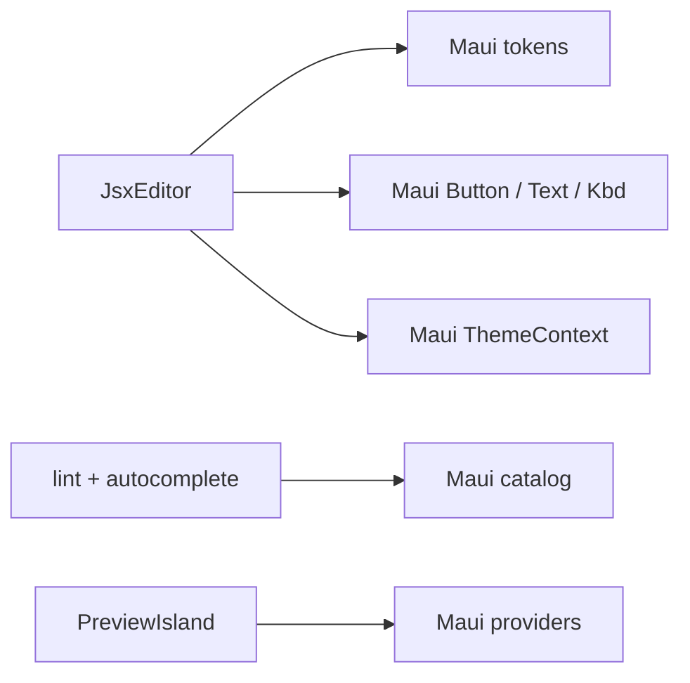
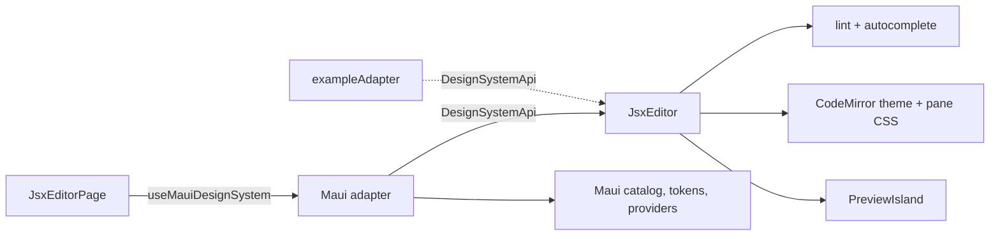
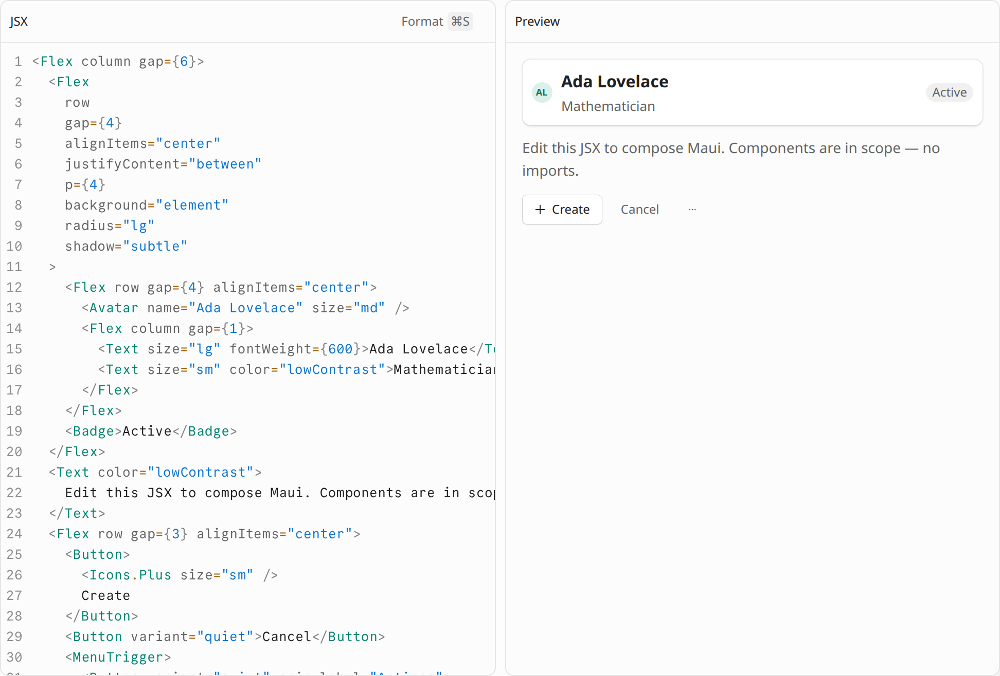
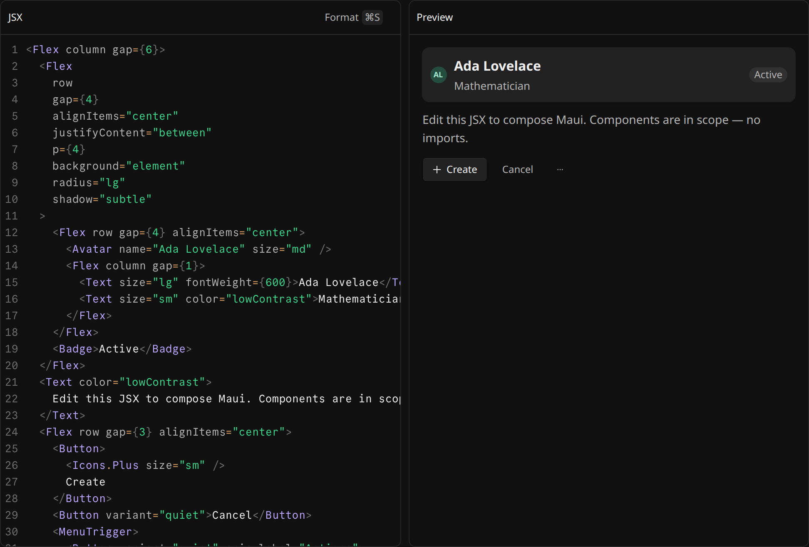
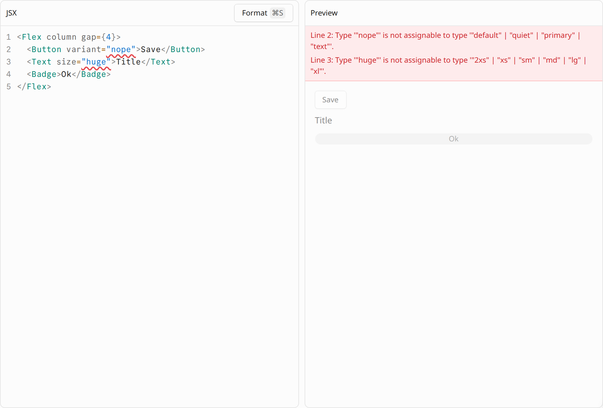
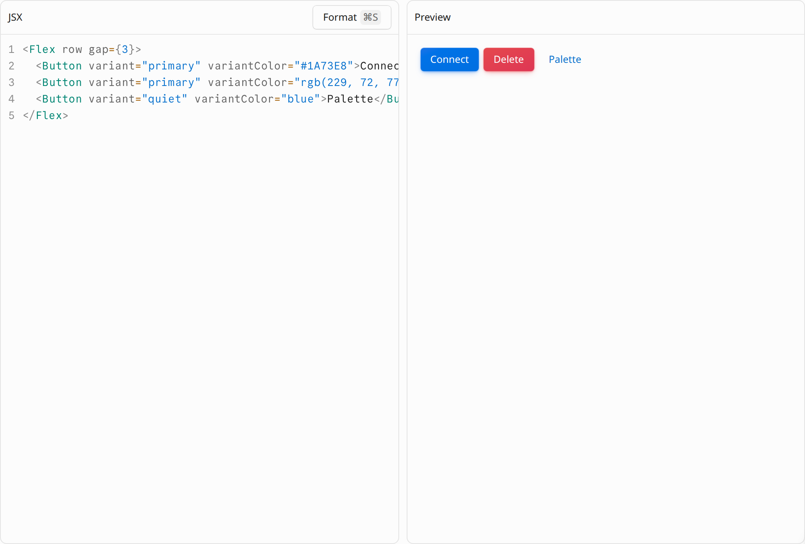
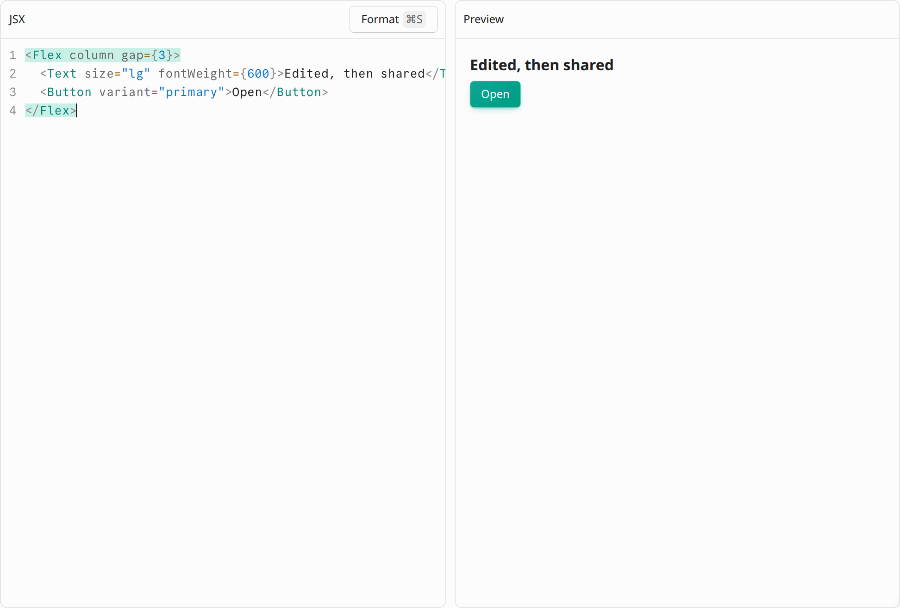
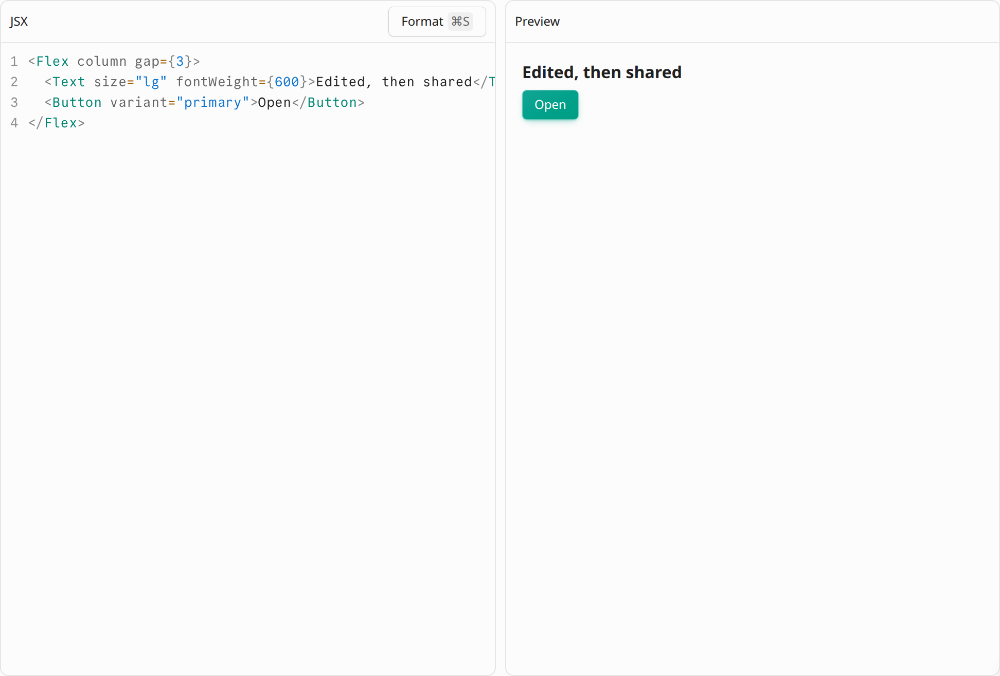
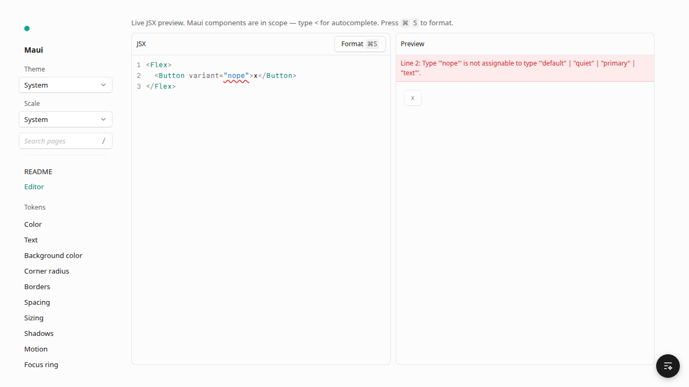
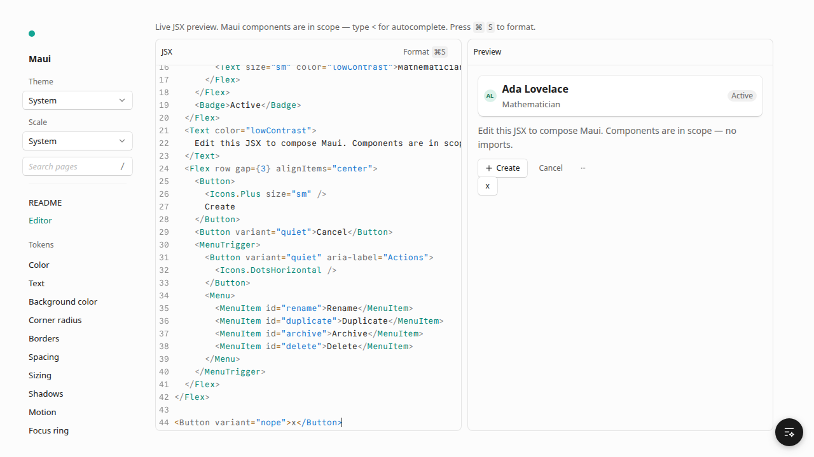

# The JSX playground runs on any design system, and ships as a gist

The gallery's live JSX editor at `/editor` (type JSX on the left, see it render on the right) no longer reaches into Maui directly. Everything Maui-specific comes in through one object, `DesignSystemApi`: which components exist, what is in scope when code runs, which colors and fonts the editor uses, and what wraps the preview. Maui provides that object with `useMauiDesignSystem()`. Another project can provide its own and reuse the editor unchanged. The editor files are published as a [public gist](https://gist.github.com/tanishqkancharla/814050126496e7ef2250d26ccdbf7edf) so other projects can copy them.

This doc reviews [PR #30](https://github.com/tanishqkancharla/maui/pull/30). The PR was written in August, 168 commits before v0.0.74. It has now been merged up to `main` (`68f077a`). `main` does not contain this work, so the PR is not redundant.

## Problem

The editor was built for the Maui gallery only. Its files imported Maui tokens for colors, spacing, and fonts, Maui's `Button`, `Text`, and `Kbd` for the header, Maui's `ThemeContext` for light and dark mode, and the Maui catalog for autocomplete and lint. Copying it into another project meant rewriting most of it.



## Solution

The editor receives a `designSystem` prop and reads everything design-specific from it. Maui's adapter is the only file that imports Maui.



The contract, in short ([[68f077a:src/apps/JsxEditor/DesignSystemApi.ts]]):

```ts
export type DesignSystemApi = {
	catalog: CatalogComponent[]          // autocomplete + lint
	previewScope: Record<string, unknown> // names user JSX can use
	iconNames: string[]
	defaultSource: string
	storageKey: string
	resolvedTheme: "light" | "dark"
	syntax: SyntaxColors
	chrome: EditorChromeTokens           // raw CSS values for panes and CodeMirror
	Chrome: DesignSystemChrome           // header label + Format button
	PreviewProviders: (props: { children?: ReactNode }) => ReactNode
	themePreference?: { value: ThemePreference; set: (p: ThemePreference) => void }
	urlStatePath?: string
}
// [!note PreviewProviders] The preview renders in its own React root, so theme and style context must be supplied again here.
// [!note themePreference] Added in the merge with main; optional.
// [!note urlStatePath] Added in the merge with main; omit it and editor state stays out of the URL.
```

For the user in the gallery, nothing changes: same panes, same autocomplete, same lint messages, same ⌘S formatting.

Look at the pane borders, syntax colors, and Format button: they all come from the Maui adapter, and they follow the gallery's theme.

:::gallery side-by-side


:::

## What the merge with `main` changed

While the PR waited, `main` added four editor features, each written against Maui directly. The merge keeps every feature and routes the Maui parts through the adapter:

| `main` feature | How it reaches the editor now |
| --- | --- |
| Shareable links: source and theme in the URL hash on `/editor` | New optional `urlStatePath` and `themePreference` fields. `urlState.ts` takes the path as an argument instead of hard-coding `/editor`. |
| Lint shows every diagnostic, not just the first | Merged as is; banner styles moved into the editor's own CSS, using a new `space2` token. |
| `Button variantColor` accepts hex and `rgb()` | `cssColor` added to the shared `AttributeCompletion` type. The lint keeps its own two-line `isCssColor` check instead of importing Maui's `Button`. |
| Commit Mono kerning and app-colored panes | New `monoFontFeatureSettings` and `appBackground` tokens. |

Two of `main`'s new test files called `collectJsxDiagnosticsFromSource(source)` and `evaluateJsx(source)` with Maui's catalog built in. The PR makes the catalog an argument, so the tests now pass Maui's `catalog` and `previewScope` explicitly. The gist script now also publishes `urlState.ts`, and the README lists `lodash` (used for debouncing URL writes) as a peer.

The banner now lists every lint error, one per line, instead of only the first:



A hex or `rgb()` `variantColor` passes lint and renders a solid button, next to a palette name:



A shared link carries the source in the URL hash. Edit the JSX, copy the address, and open it in a fresh browser: the same source and preview come back.

:::gallery carousel [Sharing a link]



:::

Checked after the merge: `npm run typecheck`, `npm test` (8 files, 50 tests, including 26 in `lint.test.ts`), and `npm run build` pass. In a browser, `/editor` writes the hash, a copied link restores the source, an invalid `variant` shows its lint banner, and the editor keeps `"ss05"` font features. A shared link's `theme: "dark"` does not switch the gallery to dark in headless Chromium; `main` behaves the same, so this is not new.

One more existing gap shows in the first post-merge capture: a second top-level element after the closing `</Flex>` (line 44, `variant="nope"`) gets no lint underline or banner. `main` behaves the same.



## Goals

- The editor and its helpers import nothing from Maui; one adapter file does.
- A second design system can host the editor by writing one `DesignSystemApi` object.
- The gallery editor behaves exactly as it does on `main`.

## Non-goals

- Publishing the editor as an npm package. It ships as copyable files in a gist.
- Moving the catalog out of Maui. `catalog.ts` stays Maui's and is not in the gist.
- Keeping the gist current automatically. `scripts/publish-jsx-editor-gist.sh` updates it on demand; the gist still holds the August files until someone runs it.

## References

- [PR #30](https://github.com/tanishqkancharla/maui/pull/30), branch `cursor/jsx-editor-gist-8c37`
- [Public gist](https://gist.github.com/tanishqkancharla/814050126496e7ef2250d26ccdbf7edf), id in [[68f077a:src/apps/JsxEditor/GIST_ID]]
- [[68f077a:src/apps/JsxEditor/DesignSystemApi.ts]], [[68f077a:src/apps/JsxEditor/mauiDesignSystem.tsx]], [[68f077a:src/apps/JsxEditor/urlState.ts]], [[68f077a:scripts/publish-jsx-editor-gist.sh]]

