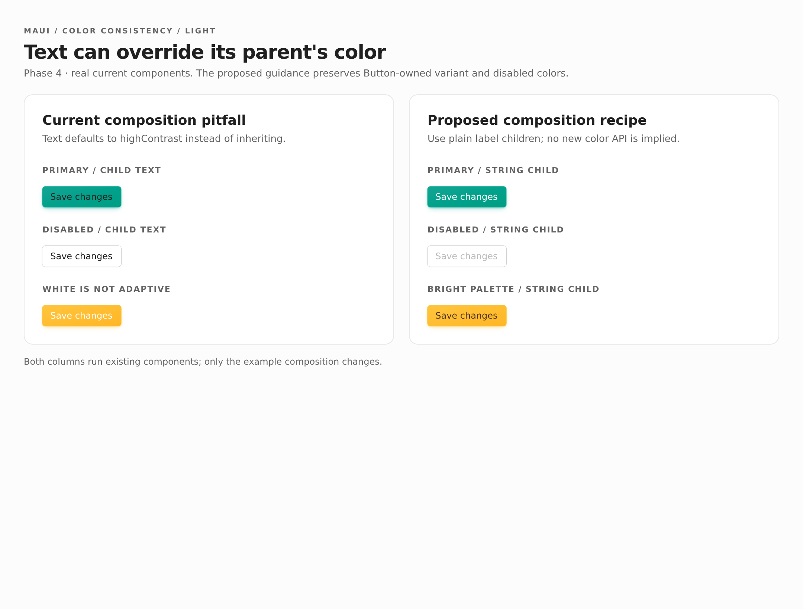
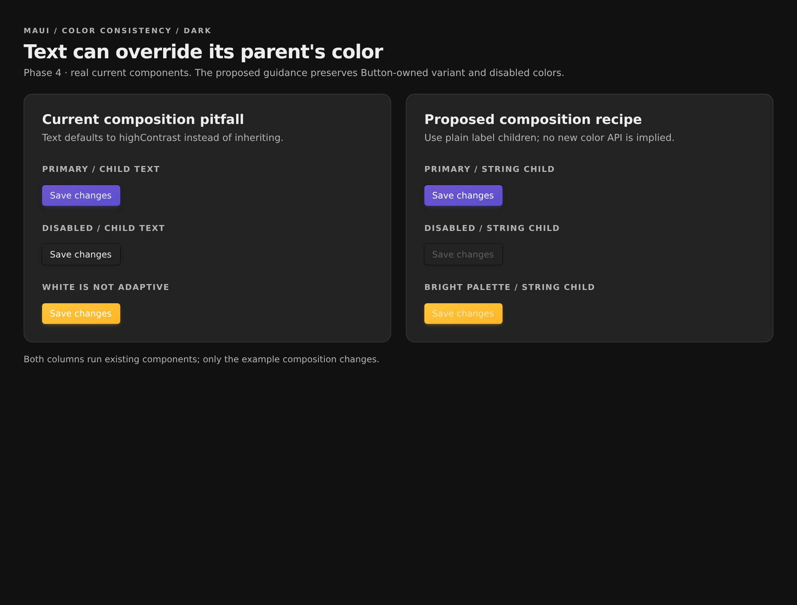
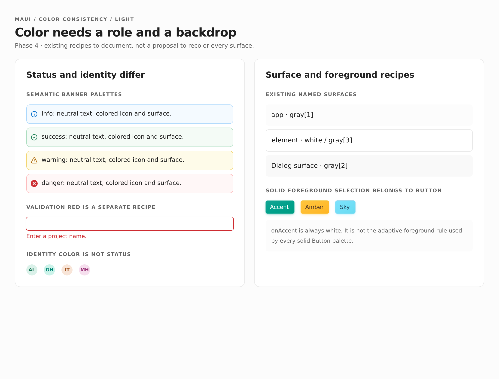
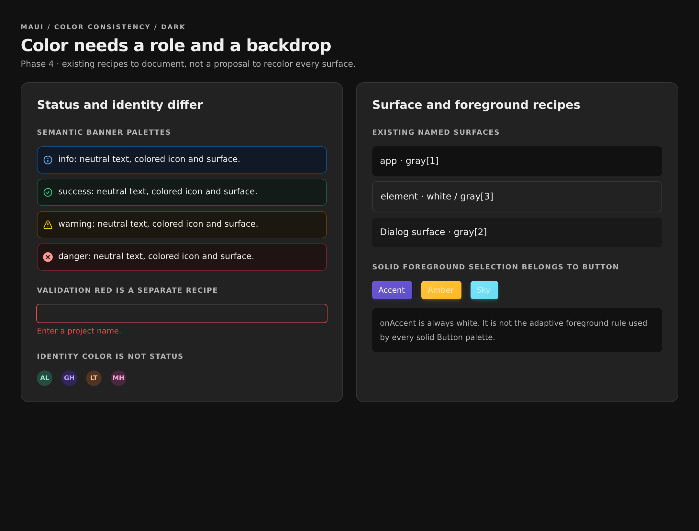
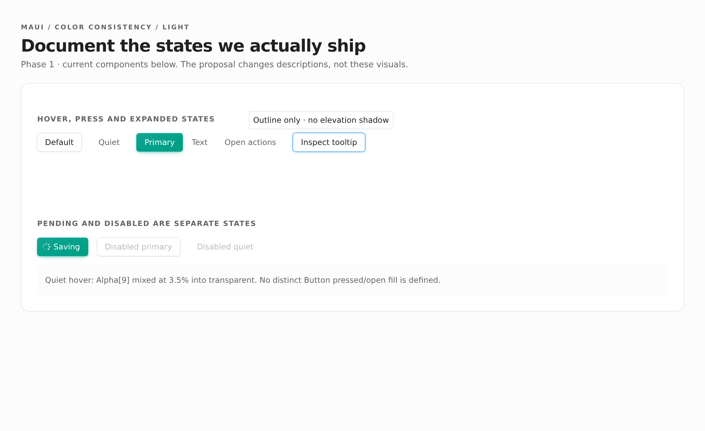
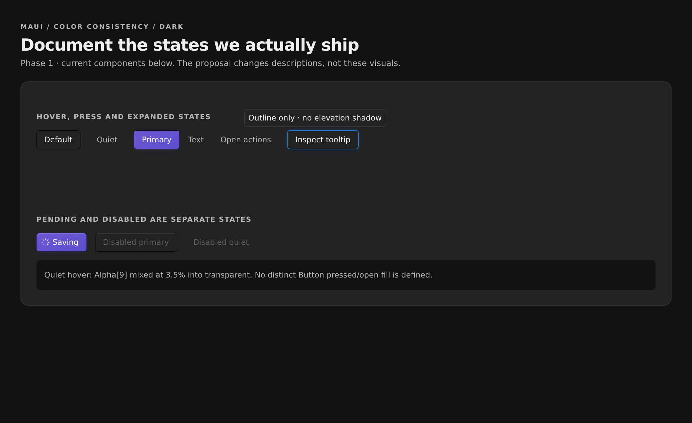
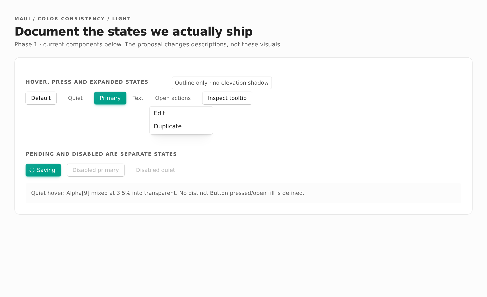
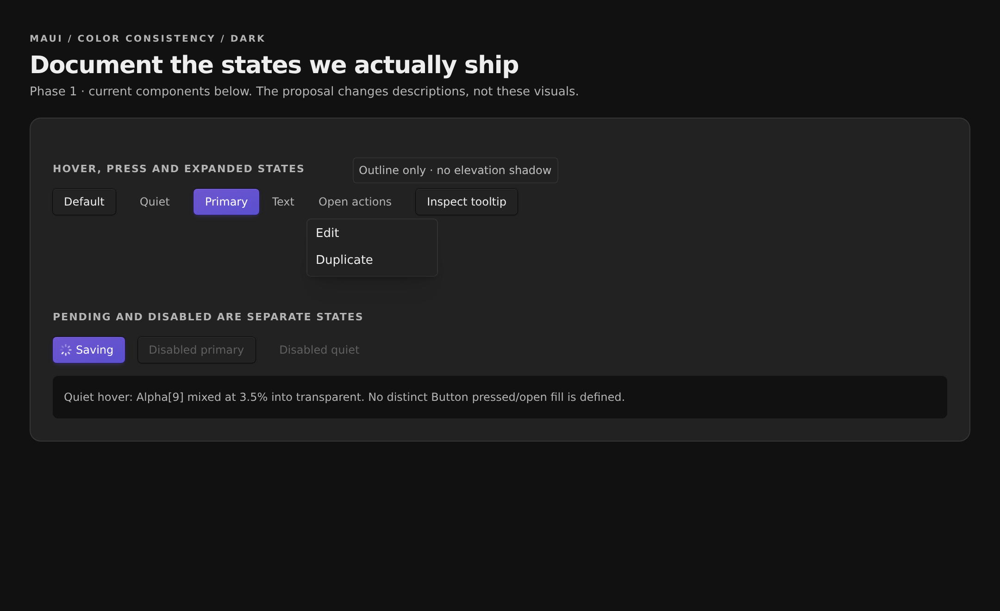

# ✅ Phase 1: Slim the skill without losing useful patterns

The [cover](README.md) separates skill guidance from component repairs. This phase changes documentation only: keep what helps an agent use Maui effectively, including internal token patterns that help it compose similar UI. Remove incidental measurements, not knowledge merely because it also appears in source.

**Today — before this phase**

The skill mixed useful composition rules with duplicated gradient arithmetic, wash percentages, shadow recipes, and state descriptions that had drifted. Source inspection was described as a last resort. Text was recommended without explaining that it sets its own color.

**Implemented**

The skill retains design choices, reusable token relationships, composition hazards, and supported usage examples. Tactical questions now go to the installed version's source. Stale recipes were deleted instead of replacing old percentages with new ones. This addresses audit C1, C2, C4 and the guidance gaps G1–G5 without creating a color encyclopedia. No runtime behavior changed.

## Keep patterns; cut incidental numbers

The test is whether a fact changes how an agent chooses or composes Maui UI. An implementation detail can earn its place when it teaches a transferable pattern.

| Kept in the skill | Removed or routed to source |
| --- | --- |
| Semantic app, element, hover, and active surfaces | Wash percentages and mixing formulas |
| Compact text-versus-fill token roles | A blanket step-9-rest/step-10-hover state recipe |
| Alpha washes depend on the backdrop; precomposed surfaces differ from transparent overlays | Alpha strengths, gradient stops, OKLCH adjustments, and shadow geometry |
| Component-managed foregrounds; explicitly colored children override inheritance | Stale pressed/open fill promises and palette-specific foreground recipes |
| Exported control, elevation, and focus treatments; apply a compound control boundary once and avoid doubling rings | Shadow offsets, blur radii, highlight strengths, and timing recipes |
| Instant hover as intent and room for focus overflow | Pixel translations of the focus-inset example |
| Supported examples, React Aria states, package boundaries, pending ownership, and accessible labeling | Pending indicator dimensions and animation duration |

Token identifiers such as `accent[11]` and spacing steps such as `padding={4}` are not incidental measurements. They remain when they identify a token or make an example useful. Unrelated typography, spacing, sizing, installation, and API references were not redesigned.

## Source lookup becomes normal

[[1402a41:skills/maui/references/design_conventions.md]] now asks agents to inspect the installed package's source for tactical questions, following components into tokens as needed. Source ships under `node_modules/maui/src/` with the documented npm alias, or `node_modules/@tanishqkancharla/maui/src/` without it. It establishes current behavior, not a guarantee of contrast or design intent.

The composition rule now states the inheritance boundary explicitly:

```diff
--- a/skills/maui/references/design_conventions.md
+++ b/skills/maui/references/design_conventions.md
@@ -27,1 +27,1 @@
-- Use Maui's `Text` component instead of raw `<span>` elements for inline text. Set typography through its `size`, `fontWeight`, `color`, `monospace`, and `tabular` props; see [Text](components/text.md). Keep semantic elements such as headings, paragraphs, labels, and links for their respective roles.
+- Use Maui's `Text` component for standalone inline typography; see [Text](components/text.md). `Text` and `text(...)` set an explicit color by default, overriding inherited variant, selected, or disabled colors. Prefer plain Button labels so the Button controls its foreground. Keep semantic elements such as headings, paragraphs, labels, and links for their respective roles.
```

## Color guidance that earns its place

[[1402a41:skills/maui/references/tokens.md]] keeps a compact scale-role guide, qualifies it as a starting point rather than a contrast guarantee, and distinguishes brand, semantic status, and decorative identity. It explains backdrop dependence and keeps Avatar foreground/background tokens paired. `onAccent` is explicitly white, not adaptive.

Exact percentages became role-bearing comments:

```diff
--- a/skills/maui/references/tokens.md
+++ b/skills/maui/references/tokens.md
@@ -84,2 +88,2 @@
-backgroundColor.elementHover   // 3.5% gray-12 wash over element
-backgroundColor.elementActive  // 7% wash
+backgroundColor.elementHover   // hovered element surface
+backgroundColor.elementActive  // active element surface
```

[[1402a41:skills/maui/references/components/buttons.md]] now explains variant intent and directs exact treatment to installed `src/components/Button.tsx`. The primary-gradient arithmetic, shadow formula, palette-specific foreground recipe, and stale open-state promise are gone. Caller-owned pending behavior remains. [[1402a41:skills/maui/references/components/menu.md]] removes the parallel open-fill claim without changing menu interaction guidance.

The shadow conventions retain control/elevation choices, compound boundaries, focus overflow, and avoiding doubled rings. They no longer prescribe Tooltip elevation or reconstruct inset highlights. Tokens link to that shared rule rather than duplicating it. Runtime shadows and Button state behavior are unchanged.

## Composition hazards stay

These are existing supported compositions, not a new API:

```tsx
<Button variant="primary">Save</Button> // follows Button state colors
<Button variant="primary"><Text>Save</Text></Button> // sets its own text color
```

Both columns below render existing components. The left uses a Text child; the right uses a plain label. **At capture time, dark Amber remained low contrast even with correct composition.** [Phase 2](02-selection-and-disabled-colors.md) has now repaired that implementation problem; it did not require another palette-specific number in the skill.

:::gallery side-by-side


:::

## Current-state specimens, not a new manual

These show status, identity, surfaces, and solid-fill foregrounds together. The retained guidance explains reusable relationships, not a recipe for every component or exception. Dark Amber and Sky make the foreground-pairing problem visible.

:::gallery side-by-side


:::

Tooltip and open Menu captures show why stale implementation prose was deleted: Tooltip is outlined, and an open quiet Button does not retain a filled state with the pointer away. Product behavior was not changed to make the old claims true.

:::gallery grid




:::

## Verification and limits

- Re-read retained claims against Button, Text, Tooltip, Banner, background, text, shadow, border, focus, and Avatar source definitions. Searched the skill for stale wash, open-fill, inset-highlight, and Tooltip-elevation claims.
- Changed-reference Markdown links: 12 checked, no missing files or heading anchors.
- `npm pack --dry-run --ignore-scripts --json`: includes component/token source and the updated skill references; no upload or publish.
- `npm run typecheck`: passed. `git diff --check`: passed.
- `SKILL.md`: unchanged at 5,580 bytes. Four changed references: 24,848 → 24,430 bytes, a 1.7% reduction while adding the missing role/composition guidance.
- Existing specimens render the unchanged components; no new product UI was introduced. They do not prove the separate proposed Phase 2 or Phase 3 fixes.

No fresh-agent evaluation was run. An optional evaluation could compare old/new guidance on custom selected UI, Button label composition, and tactical source lookup, with a stock-component negative control. It requires separate approval; this phase does not claim measured agent improvement or accessibility certification.

```changes
1402a41
skills/maui/references/design_conventions.md
skills/maui/references/tokens.md
skills/maui/references/components/buttons.md
skills/maui/references/components/menu.md
```
