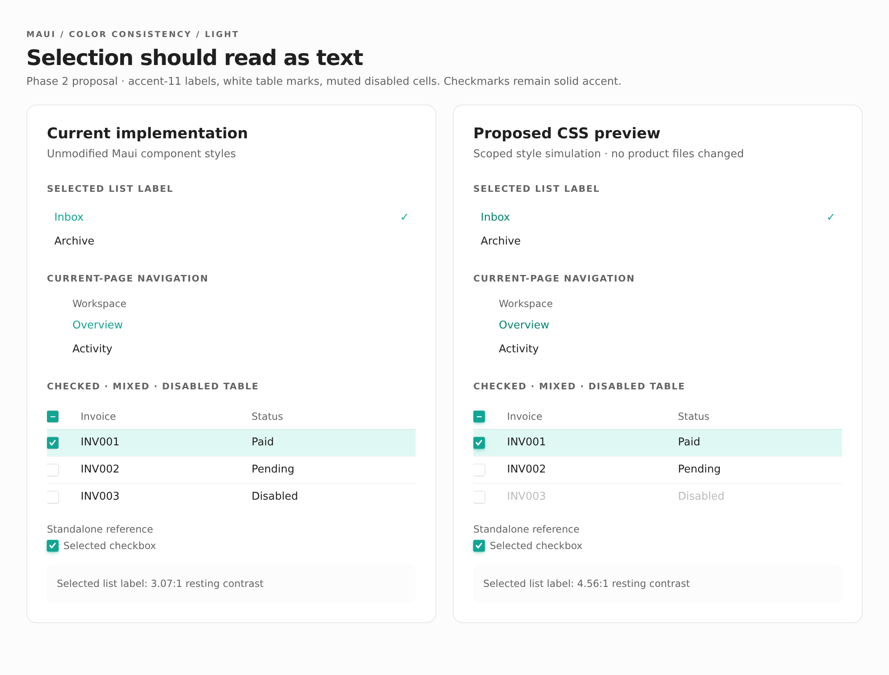
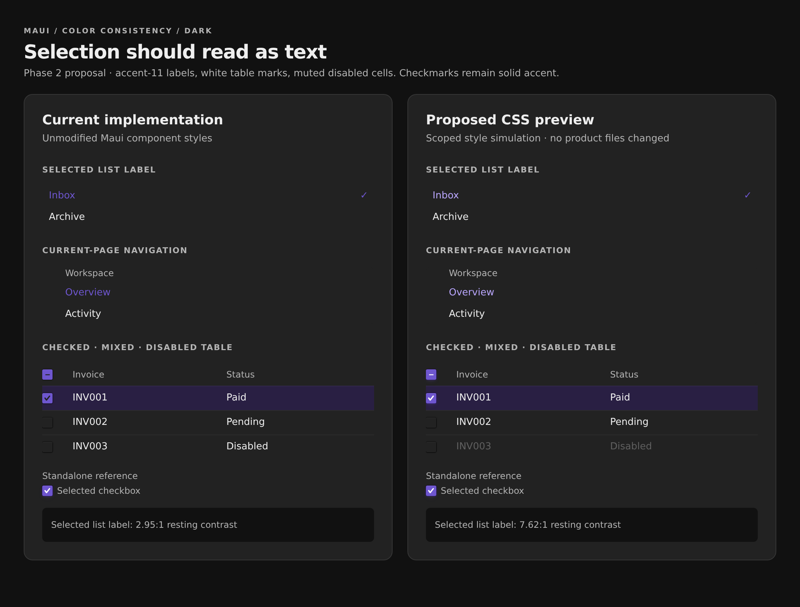

# Phase 2: Selection and disabled colors

[Phase 1](01-correct-current-guidance.md) slims the skill while retaining useful token patterns, without changing the UI. This phase changes selected labels and Table states while retaining the existing brand and selection shapes.

**Today**

ListBox/Menu and navigation labels use accent[9] rather than the accent[11] text role. The resting ListBox pair calculates to 3.07:1 in light and 2.95:1 in dark. Table's selected checkbox differs from standalone Checkbox, and TableCell's explicit text color overrides the row's inherited disabled color.

**Proposed**

Use accent[11] for normal-size selected labels; retain step 9 for marks where appropriate rather than recoloring every accent. Align Table's selected checkbox foreground and selected/focused shadow with standalone Checkbox. Apply disabled text treatment where Table cells actually set their color.

Audit coverage: I1, I2, I3, plus a foreground-pairing issue revealed by [Phase 1's dark screenshots](01-correct-current-guidance.md#composition-hazards-stay): Amber and Sky primary Buttons use a light step-12 foreground on a bright fill in dark mode. Verify all bright-palette pairs and choose a theme-stable contrasting foreground rather than assuming palette step 12 is always dark. The precise foreground change remains a proposal to settle during implementation; the screenshots do not simulate a fix for it. Update the small matching skill statements in this phase so documentation never knowingly trails the implementation.

## Sources and intended boundaries

Change selected label color in [[src/components/ListBox.tsx]]; [[src/components/Menu.tsx]] inherits these styles. Align [[src/components/navigationItem.ts]] and the Sidebar override in [[src/patterns/Sidebar.tsx]]. Do not change Sidebar icon color solely because its label changes.

Use [[src/components/Checkbox.tsx]] as the reference for [[src/components/Table.tsx]] selection marks and shadow states. Keep changes in existing style owners; do not add a new checkbox abstraction merely for this fix.

```tsx
// Proposed roles; illustrative, not a new component API.
const selectedLabel = colors.accent[11]
const selectedControlFill = colors.accent[9]
const selectedControlMark = "white"
const disabledCellText = colors.gray[8]
```

## Light and dark comparisons

Both columns render real, current Maui components with identical state and content. **Current** uses unmodified styles. **Proposed CSS preview** scopes only the planned color/shadow overrides to the right column; it is a visual proposal, not implemented code or regression-test evidence. The mixed header, checked row, disabled row, and standalone Checkbox reference are visible together.

The selected label gets darker in light mode and lighter in dark mode. Table marks become white, and the disabled row becomes muted. The checkmark beside the list label stays solid accent.

:::gallery side-by-side


:::

Computed styles in dark mode confirm current/proposed selected-label RGB values of `110 86 207` / `186 167 255`, disabled-cell values of `238 238 238` / `96 96 96`, and selected table mark values of `34 34 34` / `255 255 255`. These validate the specimen, not a product implementation.

## Proposed diff excerpts

These are review excerpts, not applied patches. In [[src/components/ListBox.tsx]], change only the selected label; the pseudo-element checkmark keeps step 9. Make the same label change in [[src/components/navigationItem.ts]] and [[src/patterns/Sidebar.tsx]].

```diff
--- a/src/components/ListBox.tsx
+++ b/src/components/ListBox.tsx
@@ -43,4 +43,4 @@
 "&[data-selected]": {
-  color: colors.accent[9],
+  color: colors.accent[11],
   fontWeight: 500,
 },
```

In [[src/components/Table.tsx]], target the cells that own the color instead of relying on inheritance from the row. Explicitly colored descendants remain a separate composition boundary.

```diff
--- a/src/components/Table.tsx
+++ b/src/components/Table.tsx
@@ -114,3 +114,3 @@
- "&[data-disabled]": {
+ "&[data-disabled] td": {
    color: colors.gray[8],
  },
```

Use the standalone Checkbox mark and selected shadow for Table. This excerpt shows the existing dynamic style keys; no new component abstraction is needed.

```diff
--- a/src/components/Table.tsx
+++ b/src/components/Table.tsx
@@ -175,1 +175,1 @@
- fill: colors.gray[3],
+ fill: "white",
@@ -203,1 +203,2 @@
   backgroundColor: colors.accent[9],
+  boxShadow: shadowVars.selectedControl,
```

Add a matching selected/indeterminate focus rule using `focusRing` plus `shadowVars.selectedControl`, as standalone Checkbox already does for selected focus. The screenshots show resting states; selected keyboard focus still needs implementation-time verification.

## Verification

Capture before/after for light and dark selected lists, navigation, Table checkbox checked/indeterminate/focused states, and disabled rows. Verify computed label/cell/mark colors, not only the ancestor's color. Probe hover/focus/selected overlaps and plain versus explicitly colored child content. Record pointer and keyboard selection across neighboring controls. Recalculate actual text/background contrast for resting and highlighted states, then run existing tests, typecheck, and build.

```changes

```
