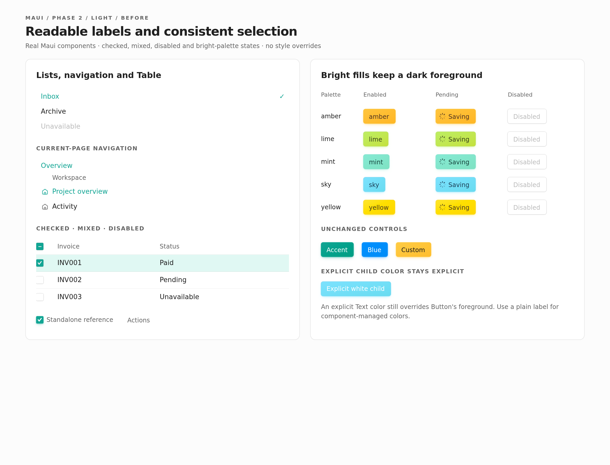
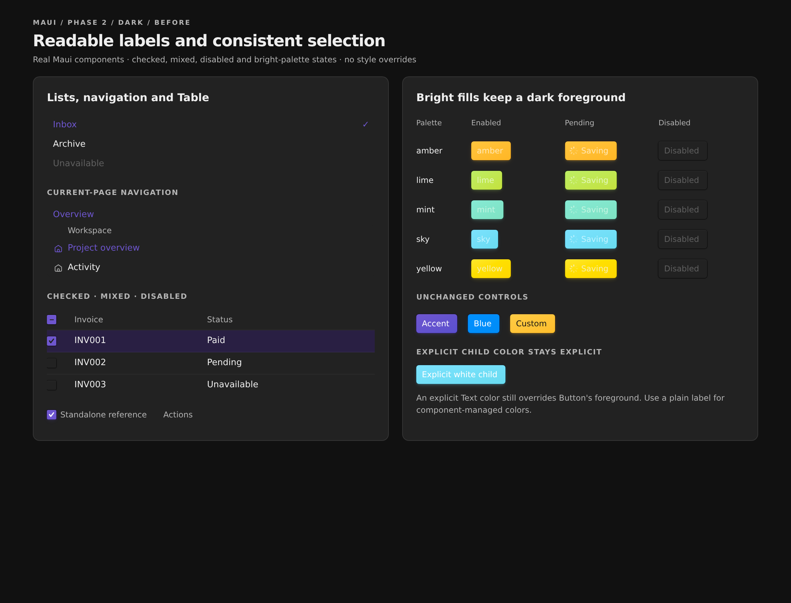
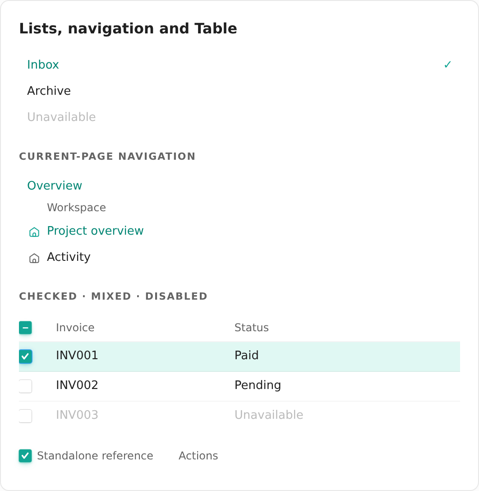
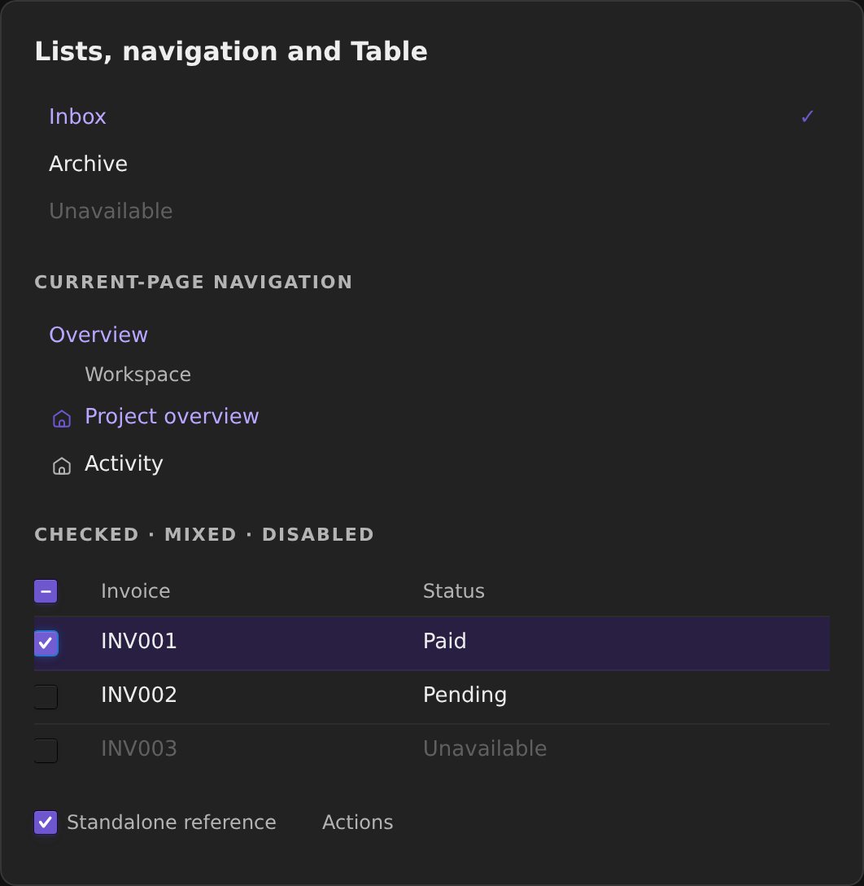
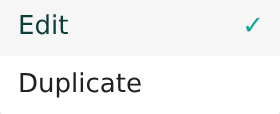
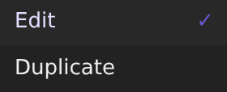

# ✅ Phase 2: Selection and disabled colors

[Phase 1](01-correct-current-guidance.md) slimmed the skill while retaining useful token patterns. This phase repairs selected labels, Table state colors, and bright-palette Button foregrounds without changing brand fills, gradients, or selection shapes.

**Today — before this phase**

ListBox/Menu and navigation labels used accent[9], a solid-fill role. Selected label contrast on the element surface was 3.07:1 light / 2.95:1 dark. Table's checked and mixed marks and selected shadows differed from standalone Checkbox. TableCell's explicit color overrode the row's inherited disabled color. All five bright primary palettes used pale step-12 text in dark mode.

**Implemented**

Selected labels use accent[11] at rest and accent[12] over hover/focus treatments. Table selection marks are white, selected shadows match standalone Checkbox, and selected/mixed keyboard focus preserves the tinted shadow under the ring. Disabled styling targets the cells that own the color. Bright Button palettes reuse the existing fill-derived foreground, keeping dark text in both themes.

Audit coverage: I1, I2, I3 and the bright-palette foreground issue found in the composition specimens. No new API, theme system, checkbox abstraction, or numeric recipe was added to the skill. Its role/composition guidance still applies unchanged.

## Actual before and after

These are captures of actual components before and after the source change, not the earlier CSS simulations. Identical state and content show a selected list item, current navigation, checked/mixed/disabled Table states, and all five bright palettes in enabled, pending, and disabled states.

Look for stronger selected text, white Table marks, muted disabled cells, and dark labels on the dark-theme bright fills. Sidebar icons remain solid accent. The explicit white Text child intentionally stays white: this phase does not override a caller's explicit descendant color.

:::gallery side-by-side




:::

## Selected labels, including the hover edge case

[[85a1580:src/components/ListBox.tsx]] owns the shared ListBox/Menu styles. [[85a1580:src/components/navigationItem.ts]] owns the shared current-page label, and [[85a1580:src/patterns/Sidebar.tsx]] updates its label override without changing the icon's accent[9] treatment.

The initial step-11-only fix measured 4.22:1 on the light hover wash, below the resting pair's 4.56:1. Selected hovered/focused labels therefore use step 12. Disabled selected items are excluded so real pointer hover cannot override their disabled foreground.

```diff
--- a/src/components/ListBox.tsx
+++ b/src/components/ListBox.tsx
@@ -43,4 +43,7 @@
     "&[data-selected]": {
-      color: colors.accent[9],
+      color: colors.accent[11],
       fontWeight: 500,
     },
+    "&[data-selected]:not([data-disabled]):is(:hover, [data-hovered], [data-focused])": {
+      color: colors.accent[12],
+    },
```

The navigation helper uses the same resting/hovered relationship. Sidebar keeps its intentional transparent current-page background and explicit icon color. ListBox/Menu checkmarks also retain accent[9].

## Bright palette foregrounds

[[85a1580:src/components/Button.tsx]] already derives a foreground from custom fill lightness. The five bright palette names now use that same helper instead of their theme-aware step 12. Other palettes, custom fills, gradients, shadows, and disabled behavior are unchanged.

```diff
--- a/src/components/Button.tsx
+++ b/src/components/Button.tsx
@@ -305,3 +305,3 @@
         scale[9],
-        darkTextOnSolid.has(color) ? scale[12] : "white",
+        darkTextOnSolid.has(color) ? onSolidText(scale[9]) : "white",
         paletteAlpha(color)[6],
```

```tsx
// Reuse existing foreground selection; do not infer darkness from a theme-aware step.
const foreground = onSolidText(fill)
```

All five bright fills resolve to the same near-black foreground in both themes. Pending labels and indicators retain that foreground; disabled labels keep the existing neutral treatment.

## Table state ownership

[[85a1580:src/components/Table.tsx]] now targets disabled cells instead of assigning a row color that TableCell overrides:

```diff
--- a/src/components/Table.tsx
+++ b/src/components/Table.tsx
@@ -114,3 +114,3 @@
-  "&[data-disabled]": {
+  "&[data-disabled] td": {
     color: colors.gray[8],
   },
```

Checked and mixed marks use white. Both states use `shadowVars.selectedControl`, and both focused states combine it with `focusRing`, following [[src/components/Checkbox.tsx]]. The unchecked focus treatment remains the ordinary control shadow. Explicitly colored descendants remain a caller composition boundary, not something a row rule forcibly recolors.

The focused row checkbox and focused mixed header below preserve their tinted selected shadow beneath blue keyboard focus. **Known pre-existing limitation:** Table's scroll boundary clips the ring's left edge. Its overflow and first-cell spacing were not changed in this phase; a separate fix was suggested.

:::gallery grid




:::

Selected Menu labels inherit the shared fix. These crops show the selected item focused over its wash, with the non-text checkmark retaining the fill-role accent.

:::gallery side-by-side


:::

## Interaction checks

The real pointer passes over neighboring list rows, toggles a Table checkbox on and off, then the keyboard modality and focus checks exercise selected and mixed controls. The Actions menu opens, receives ArrowDown/Escape, and the pointer moves across bright Buttons. These recordings use the implemented source, not CSS overrides. Close-up screenshots and computed styles establish the focus detail that is too small to judge in an overview clip.

:::gallery side-by-side


:::

## Verification and limits

Computed styles and independent sRGB contrast calculations on the element surface gave:

| Pair | Before light / dark | After light / dark |
| --- | --- | --- |
| Resting selected list label | 3.07 / 2.95 | 4.56 / 7.62 |
| Hovered selected list label | 2.84 / — | 11.16 / 11.24 |
| Amber label against base fill | 7.21 / 1.30 | 11.47 / 11.47 |
| Sky label against base fill | 7.55 / 1.24 | 12.21 / 12.21 |

- All five bright palettes: base-fill contrast 11.47–14.31:1 in both themes. Independent pixel samples along two inset vertical edges of the actual gradients measured a minimum of 10.39:1 across these specimens. This is sampled evidence, not an exhaustive gradient accessibility certification.
- Browser assertions passed for light/dark enabled/pending/disabled Button semantics and colors, checked/mixed white marks, selected shadow parity with standalone Checkbox, and focused selected/mixed shadows retaining their blue ring. Real click and Space toggles also checked the unchecked focus state.
- Disabled selected ListBox items stayed muted under real hover in both themes. Disabled Table cells match the disabled foreground; custom Text still keeps its explicit color. No normal-text contrast requirement is claimed for disabled controls.
- Selected navigation and Sidebar labels followed resting/hover roles. Sidebar icon colors, Accent/Blue/custom primary foregrounds, base fills, and shadows were unchanged in before/after computed-style comparisons.
- `npm run typecheck`: passed. `npm test -- --run`: 8 files, 50 tests passed. `npm run build`: passed with the documented large-chunk warning. `npm run build:lib` and `npm run verify-package`: passed; fresh-consumer tarball smoke test succeeded. `git diff --check`: passed.
- No permanent unit test was added for computed CSS contrast: validation used actual browser-rendered states, since the existing server-rendered tests do not calculate CSS colors. No new test framework was introduced.

The existing white-on-light Accent and Blue primary treatments still measured 3.07:1 and 3.26:1 against their base fills; they were negative controls, not claimed accessibility fixes. Together with Table focus clipping, these were suggested as separate follow-ups rather than changing brand fills or layout in this phase. Transparent navigation can inherit other backdrops; the reported contrast figures apply to the tested element surface, not every possible consumer backdrop.

[Phase 3](03-interaction-colors.md) remains the separate Calendar hover-motion fix. Nothing in this phase has been pushed, published, or deployed.

```changes
85a1580
src/components/ListBox.tsx
src/components/navigationItem.ts
src/patterns/Sidebar.tsx
src/components/Table.tsx
src/components/Button.tsx
```
