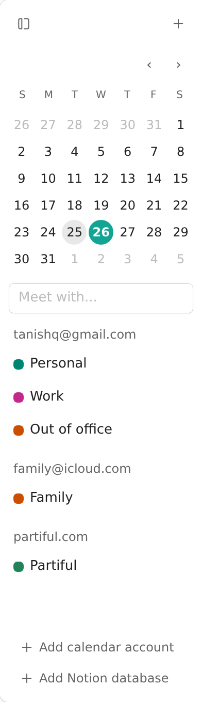
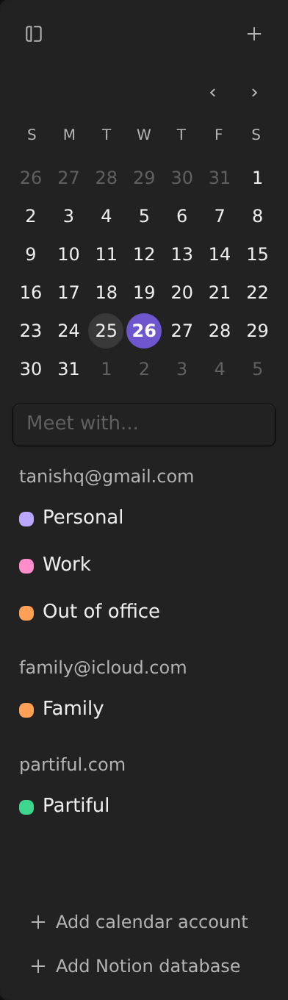
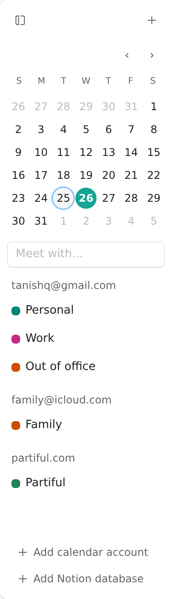
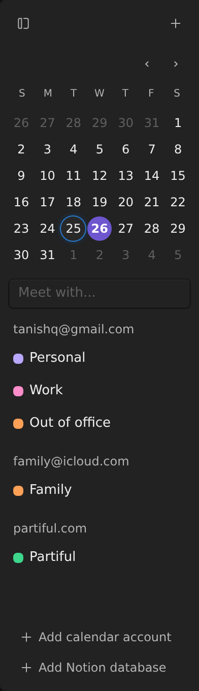

# ✅ Phase 3: Interaction colors

[Phase 2](02-selection-and-disabled-colors.md) repaired selection and disabled readability. This phase makes Calendar mini-month hover fills snap, without changing their colors or Button's state policy.

**Today — before this phase**

Calendar mini-month day buttons animated their hover background despite the skill's instant-hover rule. Button already had no distinct pressed/open fill; Select defined its own pressed/open treatment.

**Implemented**

Removed only background-color animation from mini-month day buttons. Text-color motion, hover fills, selected/today treatments, focus rings, and unrelated animation remain unchanged. The skill already states the intended rule, so it gains no implementation details.

Audit coverage: C3; final policy resolution for C1 and C2.

## Decision

Keep Button's current behavior. Stale skill prose is not a reason to restore pressed/open fills or invent a state-policy change. Preserve the primary gradient. Button has no runtime diff in this phase; [Phase 1](01-correct-current-guidance.md#color-guidance-that-earns-its-place) removed its stale recipe rather than replacing it with measurements.

The hover transition lives in [[f9ac172:src/apps/Calendar/Calendar.tsx#L1462-L1483]]. Its matching [[skills/maui/references/apps/calendar.md]] recipe already permits color-only motion on day buttons. The general rule remains in [[skills/maui/references/design_conventions.md]]. Button states live in [[src/components/Button.tsx#buttonClass]], [[src/components/Button.tsx#quietClass]], and [[src/components/Button.tsx#primaryClass]]. Select's [[src/components/Select.tsx#trigger]] is not inherited Button behavior.

## Actual Calendar states

These captures use the actual Calendar component, without CSS overrides. A browser clock fixture puts today at August 26, 2026; the app's initial selected date is August 25. The sidebar crop keeps the affected mini-month legible. The week grid, events, and other Calendar UI are unchanged.

Look for ordinary dates, the gray selected 25, the accent-filled today 26, and muted outside-month dates. Keyboard focus adds its existing ring without replacing the selected fill.

:::gallery side-by-side




:::

## Actual motion before and after

These recordings traverse neighboring days with a real moving pointer: outside-month 27, ordinary 12, selected 25, today 26, then away. **Before** was captured from unchanged source; **After** uses the committed product change. They replace the earlier browser-only CSS simulation as implementation evidence.

Watch the same hover feedback without fill interpolation. The clips illustrate the interaction; computed styles and transition events below establish the property change.

:::gallery side-by-side


:::

## Implemented diff

[[f9ac172:src/apps/Calendar/Calendar.tsx#L1462-L1483]] retains text-color motion rather than removing all motion:

```diff
--- a/src/apps/Calendar/Calendar.tsx
+++ b/src/apps/Calendar/Calendar.tsx
@@ -1463,7 +1463,7 @@ const miniDayClass = style(
   text({ size: "xs", fontWeight: 400, color: "highContrast" }),
   radius.circle,
   focusRing(),
-  motion.standard("background-color", "color"),
+  motion.standard("color"),
   {
     display: "grid",
     placeItems: "center",
```

```tsx
// Behavior, not a new API or a recipe for numeric values.
const dayMotion = motion.standard("color")
// Hover fill snaps; text color may still animate.
```

## Verification

Executed the same browser checks against unchanged and changed source in light and dark themes, with desktop hover enabled and device pixel ratio 2:

| Check | Before | After |
| --- | --- | --- |
| Computed day transition, ordinary/selected/today/outside-month | `background-color, color` | `color` |
| `background-color` transitionrun on actual pointer entry, all eight theme/state cases | Present | Absent |
| Resting and settled hover fills, foregrounds, pressed/current attributes | Baseline recorded | Identical to baseline |
| Retained text-color transition duration | Baseline recorded | Unchanged |
| Tab from selected 25 to today 26, then Shift+Tab back | Focus-visible rings present | Rings preserved |
| Enter on selected day | Selected state retained | Selected state retained |

Machine-readable samples: [before](media/interactions/before-checks.json) and [after](media/interactions/after-checks.json). Assertions waited for existing animations to finish before comparing settled colors; event listeners were installed before trusted pointer entry. The clock fixture affects dates, not CSS or input behavior.

Inspected both theme screenshots, focused states, and recording contact sheets at five frames per second. Frames show the actual pointer tour and no visual regression; transition timing conclusions come from the executed property/event checks, not from sparse video frames.

`npm run typecheck` passed; `npm test -- --run` passed (8 files, 50 tests); `npm run build` passed with the existing large-chunk warning; `git diff --check` passed. No new permanent test framework or private-style snapshot test was added for this one-line CSS fix.

All three phases are implemented and committed locally. Nothing has been pushed, merged, published, or deployed. This phase does not address the separately noted Accent/Blue primary-label contrast or first-column Table focus clipping.

```changes
f9ac172
src/apps/Calendar/Calendar.tsx
```
