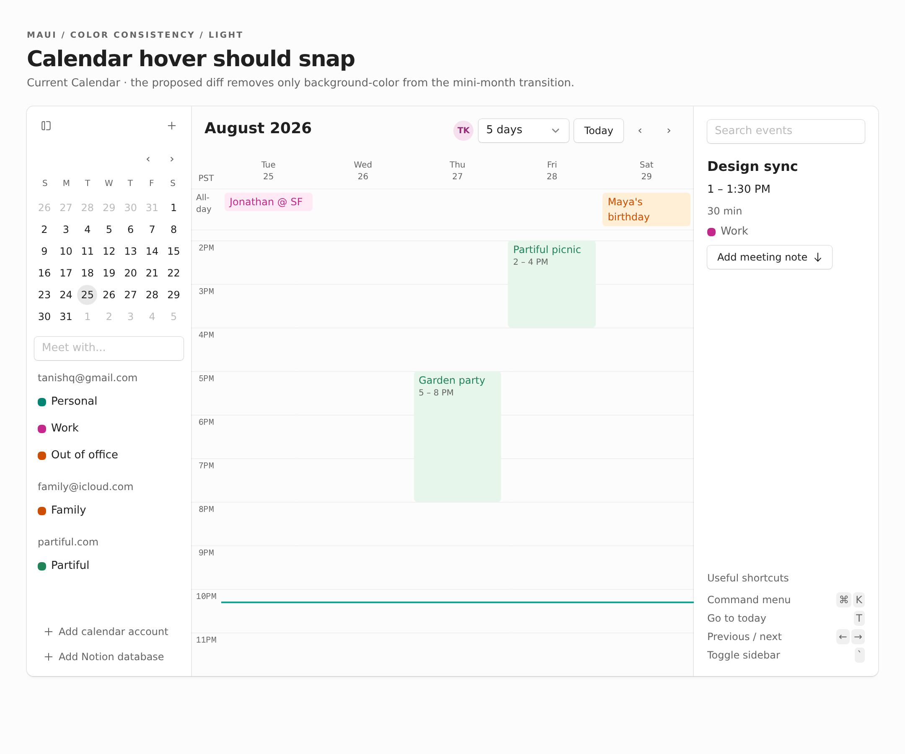

# Phase 3: Interaction colors

[Phase 2](02-selection-and-disabled-colors.md) fixes selection and disabled readability. This phase resolves hover/press/open behavior separately so a state-policy change cannot hide inside a contrast fix.

**Today**

Calendar mini-month buttons animate their hover background despite the skill's explicit instant-hover rule. Button defines hover treatments but no distinct pressed/open fill; Select defines its own pressed/open treatment.

**Proposed**

Remove only background-color animation from mini-month day buttons, preserving text-color motion and unrelated animation. For Button, the recommendation is to retain the current implementation and the accurate descriptions from Phase 1. Restoring pressed/open fills remains an explicit alternative, not an implied task.

Audit coverage: C3; final policy resolution for C1 and C2.

## Decision

Keep Button's current behavior. Stale skill prose is not a reason to restore pressed/open fills or invent a state-policy change. No Button decision blocks this phase; a separately requested behavior change would need its own proposal. Preserve the primary gradient.

## Sources

The hover transition lives in [[src/apps/Calendar/Calendar.tsx#miniDayClass]]. Its matching recipe is [[skills/maui/references/apps/calendar.md]]. Button states live in [[src/components/Button.tsx#buttonClass]], [[src/components/Button.tsx#quietClass]], and [[src/components/Button.tsx#primaryClass]]. Select's [[src/components/Select.tsx#trigger]] must not be mistaken for inherited Button behavior.

```tsx
// Proposed Calendar behavior.
const dayMotion = motion.standard("color")
// Hover fill snaps; text color may still animate.
```

## Calendar specimen and motion comparison

The current Calendar below is rendered from the existing source. The mini-month in the left sidebar is the affected area; the week grid and event colors are outside this change.



A still cannot show an 80ms transition. These short recordings move a real pointer through neighboring mini-month days. **Current** uses unmodified styles; **Proposed** is a browser-scoped CSS simulation removing only background-color from the transition, not a product patch. Both retain the same hover fill and text-color motion.

:::gallery side-by-side


:::

Computed transition properties are `background-color, color` today and `color` in the scoped proposal. The clips illustrate the timing; the computed-style check establishes which properties changed. Button pressed/open behavior stays unchanged; this preview makes no Button change.

## Proposed diff

In [[src/apps/Calendar/Calendar.tsx#miniDayClass]], keep the color transition and remove only fill interpolation:

```diff
--- a/src/apps/Calendar/Calendar.tsx
+++ b/src/apps/Calendar/Calendar.tsx
@@ -1462,7 +1462,7 @@
 const miniDayClass = style(
   text({ size: "xs", fontWeight: 400, color: "highContrast" }),
   radius.circle,
   focusRing(),
-  motion.standard("background-color", "color"),
+  motion.standard("color"),
   // Existing hover backgrounds stay unchanged.
 )
```

Button has **no runtime diff** in this phase. [Phase 1](01-correct-current-guidance.md#color-guidance-that-earns-its-place) deleted its stale recipe instead of documenting a replacement set of measurements.

## Verification

Record moving the pointer between ordinary, selected, today, and neighboring mini-month days; inspect computed transitions to confirm background-color is absent. Check light and dark modes and keyboard focus. If Button behavior changes, exercise resting, hovered, pointer-pressed, keyboard-pressed, menu-open with pointer moved away, pending, and disabled states across all four variants. Verify the state after closing a menu and ensure native and React Aria consumers match the documented contract. Update all matching skill recipes and run the relevant tests, typecheck, and build.

```changes

```
