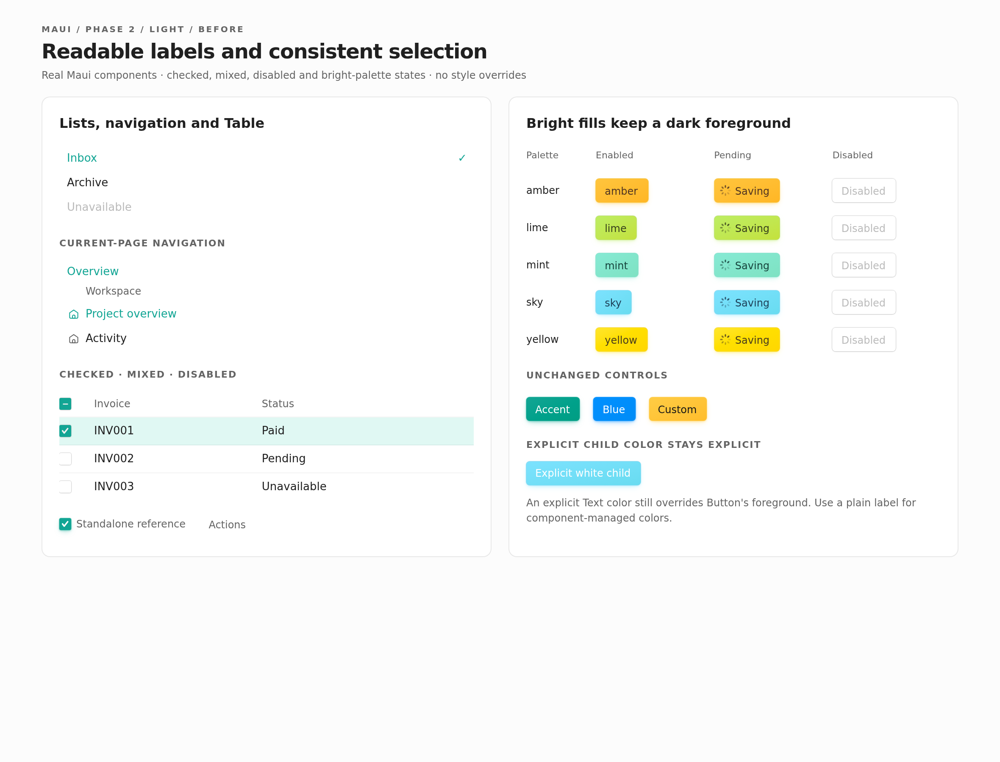
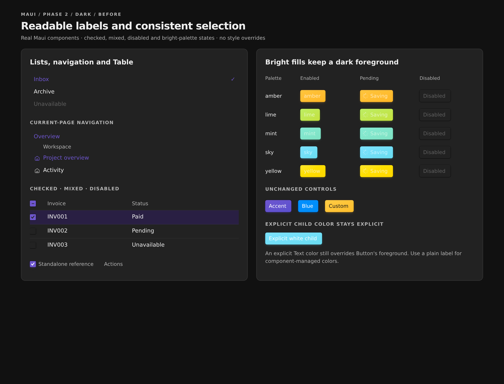

# Maui color consistency

Make the skill a guide to design intent and composition, not a second copy of the source. Slim it first; fix demonstrated component problems in separate phases. Preserve the existing brand and primary gradient treatment.

## The new boundary

The skill keeps **what agents need to use Maui effectively**: design choices, composition rules, and reusable internal token patterns. Specific hover percentages, gradient arithmetic, shadow geometry, and other incidental measurements belong in the installed package's source. Inspect that source for tactical questions rather than treating the skill as an implementation snapshot. Source establishes current behavior; it does not establish that every current contrast or interaction choice is correct.

Published npm version 0.0.70 includes components, tokens, patterns, apps, and the skill. Verified with `npm pack @tanishqkancharla/maui@latest --dry-run --ignore-scripts --json`; examples include `src/components/Button.tsx`, `src/tokens/background.ts`, and `src/apps/Calendar/Calendar.tsx`. [[package.json#L8-L15]] includes `src`, and [[package.json#L46-L49]] exposes its paths. Under the documented npm alias, inspect `node_modules/maui/src/`; without the alias, inspect `node_modules/@tanishqkancharla/maui/src/`.

## Phases

1. ✅ [Slim the skill and establish source lookup](01-correct-current-guidance.md): implemented in `1402a41`. Removed incidental recipes, replaced source-as-fallback guidance, and retained useful token patterns, design choices, composition hazards, caller responsibilities, and package boundaries.
2. ✅ [Repair selection and foreground colors](02-selection-and-disabled-colors.md): implemented in `85a1580`. Selected labels, Table checked/mixed/disabled states, and bright-palette foregrounds are repaired, with actual before/after captures and browser checks.
3. ✅ [Honor instant-hover intent](03-interaction-colors.md): implemented in `f9ac172`. Calendar hover fills snap while text-color motion, date colors, and keyboard focus remain unchanged. No extra measurements were added to the skill.

The former fourth phase, an expanded color-role manual, is folded into Phase 1 as a small set of retained composition rules. Its proposed per-component surface, palette, alpha, and disabled-state explanations are dropped.

All three phases are implemented and committed locally. Each phase can be reviewed independently; nothing has been pushed or deployed.

## Visual review

These screenshots show the actual Phase 2 source changes, not the earlier CSS simulations. They support code decisions; they are not content to copy into the skill.

:::gallery side-by-side

:::

[Phase 1](01-correct-current-guidance.md#composition-hazards-stay) retains its original Text-child comparison as evidence of a composition trap. [Phase 2](02-selection-and-disabled-colors.md#selected-labels-including-the-hover-edge-case) explains the implemented color decisions, close-up focus/Menu states, actual interaction recordings, and validation limits. [Phase 3](03-interaction-colors.md#actual-motion-before-and-after) shows actual Calendar before/after hover recordings, light/dark date states, keyboard focus, and executed transition checks.

Phase 1's original dark Amber and Sky specimens show the foreground-pairing issue that Phase 2 repaired. They are historical captures, not the current bright-palette behavior.

## Audit disposition

The [source-linked audit](https://ampcode.com/artifacts/maui-color-audit-77b5e663-9172-4156-9e10-b661fbdb33b4) records C1–C4, I1–I3, and G1–G5. This plan starts from local `main` at `d39bc4a`; the loaded skill is a symlink to `skills/maui`.

- **C1, C2, C4:** delete duplicated wash, open-state, gradient, and shadow descriptions. Do not replace old measurements with new measurements or restore old Button behavior to match stale prose.
- **I1–I3 and bright-palette contrast:** repair the components in Phase 2.
- **C3:** retain instant hover as design intent and fix Calendar in Phase 3.
- **G1:** retain one short warning about Text's explicit color and one canonical label example.
- **G2–G5:** retain role decisions, reusable internal token relationships, and Maui-specific composition boundaries that help agents extend the system. Do not add an exhaustive palette/surface/alpha/state cookbook.

## Boundaries and evidence

Keep source lookup version-specific, reuse public components and exported styles, and do not copy implementation CSS or import gallery-only helpers as public components. Do not add a new inheritance API, theme system, or shared checkbox abstraction just for these fixes.

Skill work needs link/source checks and a before/after size comparison. A fresh-agent evaluation can compare source lookup and composition tasks if explicitly approved; no evaluation runs are authorized by this spec update. Runtime fixes need actual light/dark checks, computed-style evidence, targeted regressions, and inspected screenshots/interaction clips. Existing simulated proposals are not implementation proof.

## References

- [[skills/maui/SKILL.md]]
- [[skills/maui/references/design_conventions.md]]
- [[skills/maui/references/tokens.md]]
- [[skills/maui/references/installing_maui.md]]
- [[src/components/Button.tsx]]
- [[src/components/Table.tsx]]
