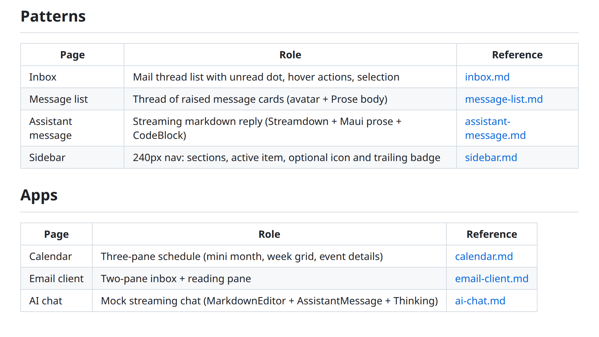
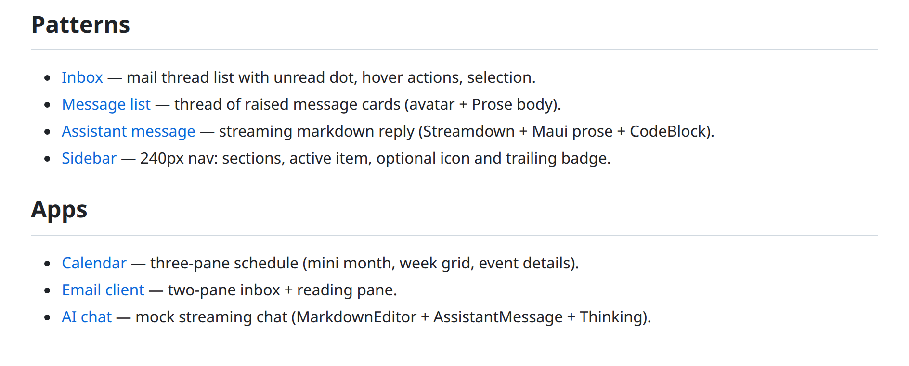
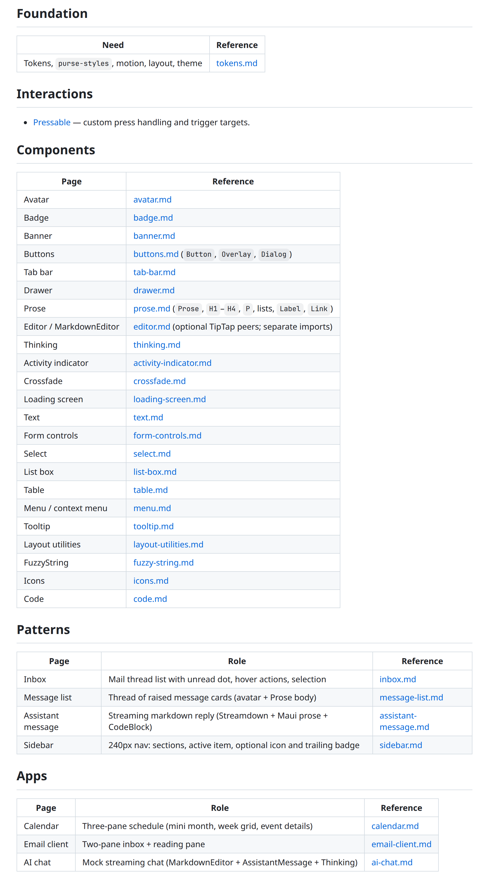
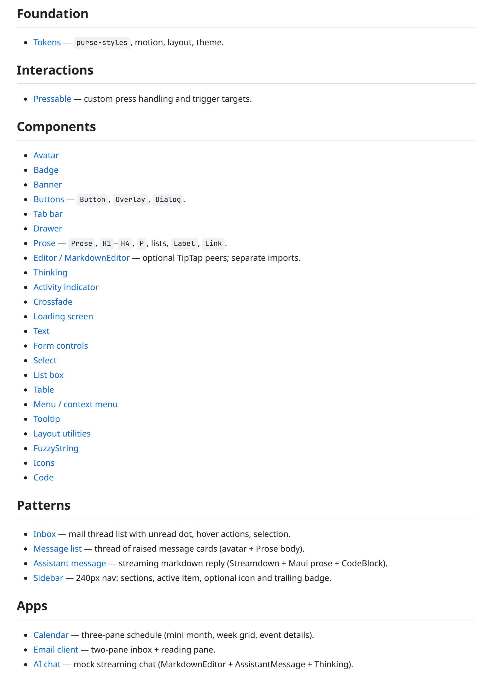

# ✅ Maui skill index as lists

An agent that loads the Maui skill reads `SKILL.md` first. That file is an index: it sends the agent to one reference page per component, pattern, or app. On `main` the index is four Markdown tables. [PR #20](https://github.com/tanishqkancharla/maui/pull/20) turns them into link lists, the same shape the Interactions section already uses.

## Problem

Tables make the index harder to read and to edit than the content needs.

- Each table row holds a name, a link, and sometimes a role. Two columns of padding carry no meaning.
- Long cells push the pipes out of line (the Editor, Activity indicator, and Menu rows already break the alignment), so every edit means re-padding.
- The file mixes two styles: Interactions is a list, every other section is a table.

## Solution

Each row becomes one list item: `[Name](path) — role`. The name is the link text, so the separate Page and Reference columns merge. Roles keep their wording. Nothing is added, removed, or re-pointed: the same 35 reference links appear before and after.

```diff [Patterns section in skills/maui/SKILL.md]
 ## Patterns

-| Page              | Role                                                               | Reference                                                        |
-| ----------------- | ------------------------------------------------------------------ | ---------------------------------------------------------------- |
-| Inbox             | Mail thread list with unread dot, hover actions, selection         | [inbox.md](references/patterns/inbox.md)                         |
-| Message list      | Thread of raised message cards (avatar + Prose body)               | [message-list.md](references/patterns/message-list.md)           |
-| Assistant message | Streaming markdown reply (Streamdown + Maui prose + CodeBlock)     | [assistant-message.md](references/patterns/assistant-message.md) |
-| Sidebar           | 240px nav: sections, active item, optional icon and trailing badge | [sidebar.md](references/patterns/sidebar.md)                     |
+- [Inbox](references/patterns/inbox.md) — mail thread list with unread dot, hover actions, selection.
+- [Message list](references/patterns/message-list.md) — thread of raised message cards (avatar + Prose body).
+- [Assistant message](references/patterns/assistant-message.md) — streaming markdown reply (Streamdown + Maui prose + CodeBlock).
+- [Sidebar](references/patterns/sidebar.md) — 240px nav: sections, active item, optional icon and trailing badge.
```

Rendered the way GitHub shows `SKILL.md`, the Patterns and Apps sections drop their three-column grid and the wrapped Assistant message row; each entry reads as one line, name first.

:::gallery side-by-side


:::

Across the whole index, from Foundation to Apps, every section now has the same shape as Interactions, and the page is about a quarter shorter.

:::gallery side-by-side


:::

Components without a role become a bare link; components whose table cell named their exports (Buttons, Prose, Editor) keep that note after the dash.

The guidance above the index is untouched. It still nudges rather than forbids: "Use Maui components. When one can't do what you need, build from the matching `react-aria-components` element…". This change adds no new rules.

## Goals

- One list style across every section of `SKILL.md`.
- Same links, same roles, same order.

## Non-goals

These were in the original August draft of the PR and are dropped after rebasing onto `main` (v0.0.74):

- **Scoped import paths.** The draft changed `"maui"` to `"@tanishqkancharla/maui"`. `main` now installs Maui under an npm alias (`pnpm add maui@npm:@tanishqkancharla/maui`) and says in `installing_maui.md` that `maui` paths assume that alias. The draft would contradict that. A few reference pages (`editor.md`, `menu.md`, `pressable.md`) still use the scoped name; making them consistent is separate work.
- **Focus-ring token names.** The draft renamed `blueAlpha[8]` / `blueAlpha[5]` to `blueA8` / `blueA5`. Source uses `colors.blueAlpha[8]` and `[5]` (`src/tokens/focusRing.ts`), so the rename was wrong.
- **Version bump to 0.0.3 and publish-workflow edits.** Every merge to `main` now cuts and publishes the next patch, and `main` rewrote `publish.yml` its own way.
- **Tables inside reference pages.** Prop and token tables in `tokens.md`, `buttons.md`, and others hold real columns of data. They stay.

## Verification

- Same set of 35 `references/…` links before and after; every target file exists; every file in `references/components/` is listed.
- No table rows remain in `SKILL.md`.
- `npm run typecheck` and `npm test` (8 files, 50 tests) pass on the rebased branch.
- The renders above come from `marked` and headless Chromium with GitHub-like styles, using `SKILL.md` from `main` (Today) and from the PR branch (Proposed). They show the layout; they are not GitHub screenshots.

## References

- [PR #20](https://github.com/tanishqkancharla/maui/pull/20), branch `cursor/maui-skill-lists-6e2d`
- [[skills/maui/SKILL.md]]
- [[skills/maui/references/installing_maui.md]]

```changes
4159e77
skills/maui/SKILL.md
```
