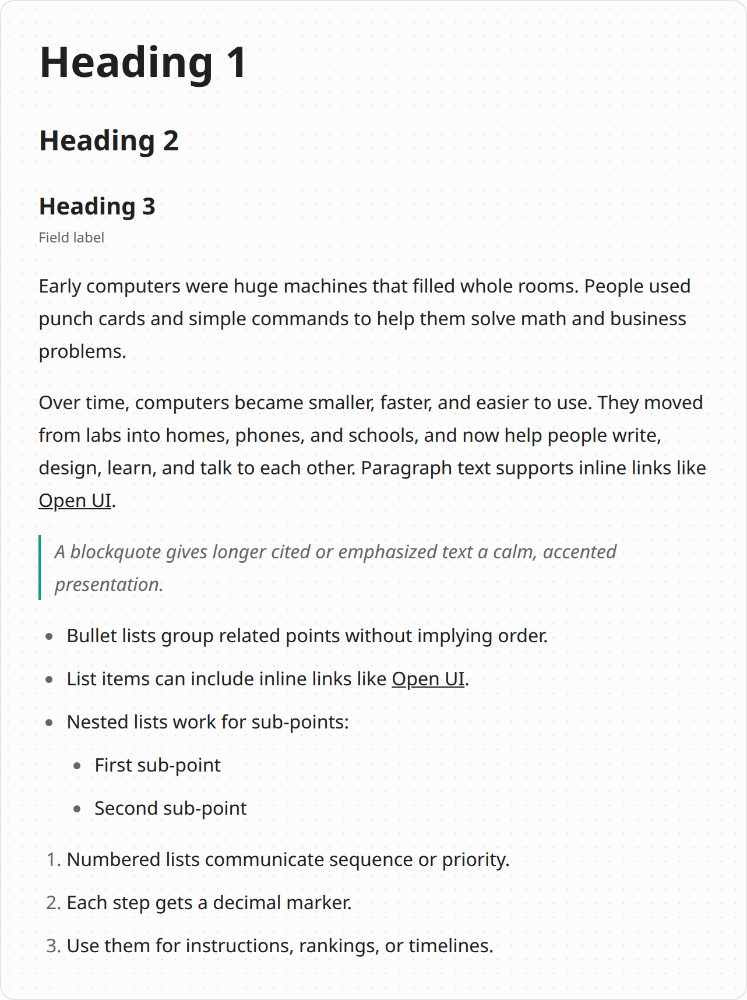

# Prose heading spacing modeled on Tailwind Typography

Markdown that Maui renders, such as an assistant reply, puts the same 10px above a heading as above any paragraph, so sections run together. This proposal gives every prose surface the vertical rhythm of Tailwind Typography's `prose` classes, expressed in Maui spacing tokens. It is implemented in [PR #79](https://github.com/tanishqkancharla/maui/pull/79) for your review. Nothing is merged.

## Problem

Maui renders long-form text in three places, and they disagree on spacing:

- **`Prose`** (React typography components) already uses Tailwind's heading margins, written as raw px in [[9fd4fd8:src/tokens/prose.ts#L70-L167]].
- **`Editor`** (TipTap) gets the same margins, because it applies `proseRhythm` to its document.
- **`AssistantMessage`** (Streamdown Markdown) only uses `proseHtml`. That sets `margin: 0` on every heading and stacks all blocks with a flat 10px `gap`. An `h2` sits as close to the paragraph above it as two paragraphs sit to each other.

Two smaller gaps apply to all three surfaces. Paragraphs sit 10px apart at every size, where Tailwind uses 16, 20, and 24px. Rhythm values are raw px, so they don't grow on the Large (touch) scale the way font sizes do.

> **This reverses part of [PR #75](https://github.com/tanishqkancharla/maui/pull/75).** That PR, merged Nov 9, chose a fixed 10px paragraph gap for every size and both platform scales. This proposal makes the gap follow Tailwind instead, and lets it scale on touch devices. If you want to keep #75's choice, set `blockGap: space(4)` (9px) at every size. The heading fix stands on its own without that.

```mermaid diff [Who sets block spacing]
 flowchart LR
     P[Prose] --> R[proseRhythm]
     E[Editor] --> R
-    A[AssistantMessage] --> H[proseHtml: flat 10px gap, headings margin 0]
+    A[AssistantMessage] --> H[proseHtml]
+    H --> R
+    R --> T[spacing tokens]
     %% ref node:R [[9fd4fd8:src/tokens/prose.ts#L236-L261]]
     %% ref node:H [[9fd4fd8:src/tokens/prose.ts#L274-L402]]
     %% ref node:T [[src/tokens/spacing.ts]]
```

## What Tailwind does

Tailwind Typography (v0.5.20) gives each block a top and bottom margin in `em`, then relies on three rules:

- `> :first-child { margin-top: 0 }`, so the text starts flush with its container.
- `h2 + *, h3 + *, h4 + *, hr + * { margin-top: 0 }`, so a heading's bottom margin alone sets the gap below it. A heading hugs its content more tightly than it is separated from the section above.
- Each size variant (`prose-sm`, `prose-base`, `prose-lg`) rescales every margin together.

Maui already copies this with a margin-top-only model. The gap between two blocks is the second block's top margin. A heading's "break" is its top margin, and its "hug" is the top margin of whatever follows it. The first child has no margin, because rules only match `* + *`. A heading directly after another heading takes the first heading's hug, which matches Tailwind's `h2 + *` rule.

## Proposed

1. `proseHtml` applies `proseRhythm` to its direct children, so Markdown headings get the same breaks and hugs as `Prose`. Its margin reset has zero specificity (`:where(&) :where(p, h1, …)`), so the rhythm always wins. Streamdown renders blocks as direct siblings, so the sibling rules match.
2. Every rhythm value is a spacing token, `spacing.value(step)`. The scale stops at 32px, so larger breaks add two steps, for example `calc(32px + 16px)` for 48px. On the Large scale each step grows about 1.25×, so the rhythm grows with the type.
3. Paragraph, list, and quote gaps follow Tailwind per size: 12 / 16 / 24px, down from 10px.
4. Code blocks and tables get extra room on both sides (16 / 24 / 32px), and horizontal rules get more (40 / 48 / 56px), as in Tailwind.
5. Font sizes, line-heights, weights, and list indents do not change. They already match Tailwind.

### Values at `md` (Tailwind `prose-base`, 16px body)

"Today" lists Markdown first, then `Prose`. Proposed values are px on the default scale, with the token after them.

| Gap | Tailwind | Today | Proposed |
| --- | --- | --- | --- |
| Paragraph, list, quote | 20 | 10 · 10 | 16 `space(8)` |
| Code block | 24 | 10 · 10 | 24 `space(12)` |
| Table | 28 | 10 · 10 | 24 `space(12)` |
| Horizontal rule | 48 | 10 · 10 | 48 `space(16, 8)` |
| h1 break / hug | 0 / 32 | 10 / 10 · 48 / 32 | 48 `space(16, 8)` / 32 `space(16)` |
| h2 break / hug | 48 / 24 | 10 / 10 · 48 / 24 | 48 `space(16, 8)` / 24 `space(12)` |
| h3 break / hug | 32 / 12 | 10 / 10 · 32 / 12 | 32 `space(16)` / 12 `space(6)` |
| h4 break / hug | 24 / 8 | 10 / 10 · 24 / 8 | 24 `space(12)` / 9 `space(4)` |
| List item | 8 | 8 · 8 | 9 `space(4)` |

Line-heights stay at Tailwind's values: body 28, h1 40, h2 32, h3 32, h4 24.

### Values at `sm` and `lg`

| Gap | Tailwind `sm` | Proposed `sm` | Tailwind `lg` | Proposed `lg` |
| --- | --- | --- | --- | --- |
| Paragraph, list, quote | 16 | 12 | 24 | 24 |
| Code block / table | 20 / 24 | 16 | 32 / 32 | 32 |
| Horizontal rule | 40 | 40 | 56 | 56 |
| h1 break / hug | 0 / 24 | 32 / 24 | 0 / 40 | 56 / 40 |
| h2 break / hug | 32 / 16 | 32 / 16 | 56 / 32 | 56 / 32 |
| h3 break / hug | 28 / 8 | 24 / 9 | 40 / 16 | 40 / 16 |
| h4 break / hug | 20 / 8 | 16 / 9 | 32 / 8 | 32 / 9 |
| List item | 4 | 4 | 12 | 12 |

Where the two differ, the cause is either the token scale or a deliberate choice:

- The scale has no 8, 20, or 28px step, so hugs of 8 become 9, and `sm` breaks of 28 and 20 become 24 and 16.
- Paragraph gaps at `sm` and `md` are one step tighter than Tailwind (12 and 16 instead of 16 and 20). Replies and editor documents sit in app chrome, so they should read denser than an article.
- Tailwind sets `h1` top margin to 0 and expects the `h1` to open the page. Maui keeps a break before an `h1` that appears mid-document. An `h1` at the top still starts flush, under the first-child rule.

## Before and after

The new "Long-form reply" panel on the gallery's Assistant message page renders the same Markdown in both captures: h1 to h4, paragraphs, a bullet and a numbered list, a code block, and a table. Before, every block is 10px apart. After, each `h2` opens a section 48px below the text above it and sits 24px above its own content.

:::gallery side-by-side


:::

:::gallery side-by-side


:::

The `Prose` component already had heading margins, so it changes only slightly. Paragraphs and lists move from 10 to 16px apart:

:::gallery side-by-side


:::

`Prose` also wraps every gallery page, so the space between a page's paragraphs and demo panels grows from 10 to 16px.

## Implementation

The size table holds tokens instead of numbers. `space` sums steps when one step is too small:

```ts [src/tokens/prose.ts]
const space = (step: Space, ...more: Space[]) =>
	more.length === 0
		? spacing.value(step)
		: `calc(${[step, ...more].map((s) => spacing.value(s)).join(" + ")})`

md: {
	h2: { /* … */ marginTop: space(16, 8), marginBottom: space(12) },
	blockGap: space(8),
	figureGap: space(12),
	ruleGap: space(16, 8),
	// …
}
```

`proseRhythm` adds code-block, table, and rule gaps beneath the heading rules. Wrapping the code-block and table selector in `:where()` keeps its specificity at zero, so a heading right before a code block still hugs it:

```ts {6-8}
return style({
	[`${selector} > * + *`]: { marginTop: m.blockGap },
	[`${selector} > * + ${figure}, ${selector} > ${figure} + *`]: { marginTop: m.figureGap },
	[`${selector} > * + hr, ${selector} > hr + *`]: { marginTop: m.ruleGap },
	[`${selector} > h2 + *`]: { marginTop: m.h2.marginBottom },
	[`${selector} > ${notHeading} + h2`]: { marginTop: m.h2.marginTop },
	// … h1, h3, h4
})
// [!note figure] `:where(pre, table, .maui-code-block, [data-streamdown="table-wrapper"], .tableWrapper)`
// [!note L6] Higher specificity than the figure rule, so the heading hug wins.
```

`proseHtml` composes `proseRhythm(size)` and drops its flat `gap` and per-element `margin: 0`:

```diff
-return style({
+return style(proseRhythm(size), {
 	display: "flex",
 	flexDirection: "column",
-	gap: blockGap,
+	[blockMarginReset]: { margin: 0 },
```

## Verification

- Measured in Chromium on the gallery page: h1 0 (first child), paragraph 32 below it, h2 48, hug 24, list 16, h3 32, hug 12, code 24, h4 24, hug 9, table 24. In the streaming demo the first heading still starts at 0 while tokens arrive.
- `npm run typecheck` and `npm test` (50 tests) pass.

## Open questions

- **Paragraph gap.** 16px at `md` is the biggest visible change across the gallery, and it undoes [PR #75](https://github.com/tanishqkancharla/maui/pull/75)'s fixed 10px. Matching Tailwind's 20px exactly would mean `calc(16px + 4px)`. Keeping #75's gap (`space(4)`, 9px) would limit this change to headings, code, tables, and rules.
- **Scale steps.** Breaks above 32px are sums of two steps. The alternative is to add 20, 24, and 28 steps (40, 48, 56px) to the spacing scale. That reads more simply, but it widens the public `spacing.padding` API.
- **`h1` top margin.** It keeps a mid-document break, where Tailwind always uses 0.

## References

- Tailwind Typography v0.5.20, `src/styles.js` (`sm`, `base`, `lg`, and `DEFAULT` table margins)
- [[9fd4fd8:src/tokens/prose.ts]], [[src/tokens/spacing.ts]], [[src/patterns/AssistantMessage.tsx#AssistantMessage]], [[src/components/Editor.tsx#Editor]]
- Specimen: [[b725513:src/pages/AssistantMessagePage.tsx]]

```changes
992466f..9fd4fd8
src/tokens/prose.ts
src/pages/AssistantMessagePage.tsx
```
