# Prose heading spacing modeled on Tailwind Typography

Markdown that Maui renders, such as an assistant reply, put the same 10px above a heading as above any paragraph, so sections ran together. This proposal gives headings, code blocks, tables, and rules the vertical rhythm of Tailwind Typography's `prose` classes, expressed in Maui spacing tokens. It also routes every way of rendering prose through one spacing definition. It is implemented in [PR #79](https://github.com/tanishqkancharla/maui/pull/79). Nothing is merged.

**Changed since your first review:**

- Paragraphs keep [PR #75](https://github.com/tanishqkancharla/maui/pull/75)'s fixed 10px gap at every size and on both scales.
- [Ways to render prose](#ways-to-render-prose) lists every path and explains `proseHtml`. [One source of truth for spacing](#one-source-of-truth-for-spacing) is implemented, and [Decisions](#decisions) lists what is not.
- [Spacing across sizes and scales](#spacing-across-sizes-and-scales) gives every gap at every size and scale.
- [Try it](#try-it) is a live flow where you switch size and scale and read each gap.

## Ways to render prose

Maui has two kinds of prose. **React prose** is built from Maui's typography components (`H2`, `P`, `Ul`, …) inside a `Prose` container. Each component carries its own class. **HTML prose** is markup that something else produced: Streamdown turns Markdown into `<h2>` and `<p>`, and TipTap edits a tree of plain elements. No Maui component renders those tags, so nothing gives them a class.

`proseHtml(size)` is the style for HTML prose. You put it on the element that wraps the markup, and it styles the tags inside by selector (`& h2`, `& p`, `& table`, …). It also spaces the blocks.

| Path | Used by | Type styles from | Spacing from, today | Spacing from, proposed |
| --- | --- | --- | --- | --- |
| `Prose` + typography components | Gallery pages, React docs | `prose(size)` classes on each component | `proseRhythm` | `proseRhythm` |
| `AssistantMessage` | Assistant replies (Streamdown Markdown), `AiChat` | `proseHtml` selectors | Flat 10px flex `gap`; headings have no margin | `proseRhythm`, through `proseHtml` |
| `Editor`, `MarkdownEditor` | TipTap documents, `AiChat` composer, Halo | `proseHtml` selectors | `proseHtml` on the wrapper and `proseRhythm` on the document, composed by `Editor` | `proseRhythm`, through one `proseHtml(size, "& > .ProseMirror")` call |
| `proseHtml` (exported) | Apps styling their own HTML | `proseHtml` selectors | Flat 10px flex `gap` | `proseRhythm` |
| `proseRhythm` (exported) | Apps spacing their own blocks | None | `proseRhythm` | `proseRhythm` |
| `prose(size)` (exported) | Single lines of reading text, such as `AiChat` tool calls | `prose(size)` | None | None |

`proseContainerStyle` and `proseMaxWidth` only set the reading width, so they are left out.

```mermaid diff [Where each path gets its block spacing]
 flowchart LR
     P[Prose] --> R[proseRhythm]
-    E[Editor] --> H[proseHtml]
-    E --> R
-    A[AssistantMessage] --> H
-    H --> G[Flat 10px gap, headings margin 0]
+    E[Editor] --> H[proseHtml]
+    A[AssistantMessage] --> H
+    H --> R
+    R --> T[spacing tokens]
     %% ref node:R [[c2fd65b:src/tokens/prose.ts#L237-L262]]
     %% ref node:H [[c2fd65b:src/tokens/prose.ts#L278-L405]]
     %% ref node:P [[src/components/Prose.tsx#Prose]]
     %% ref node:E [[c2fd65b:src/components/Editor.tsx#L17-L28]]
     %% ref node:A [[src/patterns/AssistantMessage.tsx#AssistantMessage]]
     %% ref node:T [[src/tokens/spacing.ts]]
```

## One source of truth for spacing

This part is implemented. `proseRhythm(size, selector)` is now the only place prose block spacing is defined:

- `Prose` applies it to its children.
- `proseHtml` composes it. A new optional `root` argument names the element whose children are the blocks: `&` by default, `& > .ProseMirror` for TipTap.
- `Editor` makes one `proseHtml` call instead of composing `proseHtml` and `proseRhythm` itself, and drops its own flex column.
- `AssistantMessage` no longer repeats the flex column that `proseHtml` sets.

A change to heading or paragraph spacing is now one edit in [[c2fd65b:src/tokens/prose.ts#L72-L166]], and it reaches all four paths.

```ts [src/components/Editor.tsx]
const surfaceClassName = useStyles(
	editorClass,
	proseHtml(size, "& > .ProseMirror"),
)
```

`proseHtml` resets block margins with a zero-specificity selector (`:where(&) :where(p, h1, …)`), so the rhythm's margins always win, whatever order purse-styles emits the composed classes in.

## Decisions

Each of these goes further toward one way of rendering prose. None is in the PR.

1. **Type styles are still defined twice.** `prose(size)` styles React prose and `proseHtml`'s selectors style HTML prose. Sizes and line-heights come from one table, but the rest has drifted: links inherit their weight in React prose and are weight 500 in HTML prose, and HTML prose draws its own list markers and quote bar. Code, tables, horizontal rules, and images are styled only in HTML prose. Making both read one element table would change how links and lists look on one of the surfaces.
2. **`Prose` could style plain HTML too, folding `proseHtml` into the container.** Then `<Prose>` would be the only entry point. The risk is that `proseHtml`'s selectors reach every descendant. That includes demo panels on gallery pages and any table or list an app nests inside `Prose`. It needs a scoping rule before it is safe.
3. **Public API.** `proseHtml` gains an optional second argument, which is additive. `proseRhythm` stays exported for apps that space their own blocks. Removing or renaming either breaks Halo and other consumers.
4. **Spacing steps above 32px add two steps together**, for example `calc(32px + 16px)` for 48px. The alternative is to add 40, 48, and 56px steps to the spacing scale. That reads more simply, but it widens the public `spacing.padding` API.
5. **`h1` top margin.** Maui keeps a break above an `h1` in the middle of a document. Tailwind always uses 0, because it expects an `h1` to open the page. An `h1` at the top starts flush in both.
6. **The live preview needs preview deployments diffmap.dev can reach.** See [Try it](#try-it).

## What Tailwind does

Tailwind Typography (v0.5.20) gives each block a top and bottom margin in `em`, then relies on three rules:

- `> :first-child { margin-top: 0 }`, so text starts flush with its container.
- `h2 + *, h3 + *, h4 + *, hr + * { margin-top: 0 }`, so a heading's bottom margin alone sets the gap below it. A heading sits closer to its own content than to the section above.
- Each size variant (`prose-sm`, `prose-base`, `prose-lg`) rescales every margin together.

Maui's `proseRhythm` follows the same model with top margins only. The gap between two blocks is the second block's top margin. A heading's **break** is the gap above it, and its **hug** is the gap below it, before whatever follows. The first child gets no margin. A heading directly after another heading takes the first one's hug, as Tailwind's `h2 + *` rule does.

## Proposed values

At `md`, which matches Tailwind's `prose-base` with 16px body text. "Today" shows Markdown first, then the `Prose` component.

| Gap | Tailwind | Today | Proposed |
| --- | --- | --- | --- |
| Paragraph, list, quote | 20 | 10 · 10 | 10, fixed, as in #75 |
| Code block | 24 | 10 · 10 | 24 `space(12)` |
| Table | 28 | 10 · 10 | 24 `space(12)` |
| Horizontal rule | 48 | 10 · 10 | 48 `space(16, 8)` |
| h1 break / hug | 0 / 32 | 10 / 10 · 48 / 32 | 48 `space(16, 8)` / 32 `space(16)` |
| h2 break / hug | 48 / 24 | 10 / 10 · 48 / 24 | 48 `space(16, 8)` / 24 `space(12)` |
| h3 break / hug | 32 / 12 | 10 / 10 · 32 / 12 | 32 `space(16)` / 12 `space(6)` |
| h4 break / hug | 24 / 8 | 10 / 10 · 24 / 8 | 24 `space(12)` / 9 `space(4)` |
| List item | 8 | 8 · 8 | 9 `space(4)` |

The scale has no 8px step, so hugs of 8 become 9. Font sizes, line-heights, weights, and list indents do not change. They already match Tailwind: body 28, h1 40, h2 32, h3 32, h4 24 line-height at `md`.

## Spacing across sizes and scales

Each value is in px, measured in Chromium on the [playground](#try-it). "Desktop" is the default scale. "Touch" is the Large scale that coarse pointers get, where each spacing token steps up about 1.25×. The 10px paragraph gap is the one value that stays put.

| Gap | Small, desktop | Small, touch | Default, desktop | Default, touch | Large, desktop | Large, touch | Tailwind sm · base · lg |
| --- | --- | --- | --- | --- | --- | --- | --- |
| h1 break / hug | 32 / 24 | 40 / 30 | 48 / 32 | 60 / 40 | 56 / 40 | 70 / 50 | 0/24 · 0/32 · 0/40 |
| h2 break / hug | 32 / 16 | 40 / 20 | 48 / 24 | 60 / 30 | 56 / 32 | 70 / 40 | 32/16 · 48/24 · 56/32 |
| h3 break / hug | 24 / 9 | 30 / 12 | 32 / 12 | 40 / 16 | 40 / 16 | 50 / 20 | 28/8 · 32/12 · 40/16 |
| h4 break / hug | 16 / 9 | 20 / 12 | 24 / 9 | 30 / 12 | 32 / 9 | 40 / 12 | 20/8 · 24/8 · 32/8 |
| Code block, table | 16 | 20 | 24 | 30 | 32 | 40 | 20–24 · 24–28 · 32 |
| Horizontal rule | 40 | 50 | 48 | 60 | 56 | 70 | 40 · 48 · 56 |
| Paragraph, list, quote | 10 | 10 | 10 | 10 | 10 | 10 | 16 · 20 · 24 |
| List item | 4 | 5 | 9 | 12 | 12 | 16 | 4 · 8 · 12 |

Heading breaks and hugs grow with the size, as Tailwind's do. At Small, the 28px h3 break and 20px h4 break are not on the spacing scale, so they become 24 and 16. Heading type grows about 1.2× on the touch scale, and its gaps grow about 1.25× with it, so the proportions hold. Paragraphs do not grow, so on touch devices headings stand further apart from body text than on desktop.

## Try it

Switch size and scale and read each gap in the right gutter. Accent bars are heading breaks and hugs, and gray bars are the 10px paragraph gap. The flow runs the real `AssistantMessage` from the gallery's stories.

```flow [Heading and paragraph spacing by size and scale]
prose-spacing--default
  prose-spacing--small: Switch size to Small
    prose-spacing--small-touch: Switch scale to Touch
  prose-spacing--large: Switch size to Large
    prose-spacing--large-touch: Switch scale to Touch
  prose-spacing--touch: Switch scale to Touch
```

**Where the flow runs.** Locally, run `npm run dev:previews`, then `npx product-doc serve .diffmap/specs/prose-heading-spacing/`. On diffmap.dev it loads `previews.html` from the PR's Vercel preview deployment, and two things currently stop it:

- Maui's preview deployments are behind Vercel Authentication, so diffmap.dev gets a sign-in redirect. Turning off Deployment Protection for previews, or exempting `/previews`, fixes this.
- Vercel shortens long branch names in the preview hostname. This branch's alias ends in a hash (`maui-git-cursor-prose-heading-e58d4b-…`), so the `{branch}` template in `.diffmap/config.json` cannot match it. Branch names of about 15 characters or fewer fit.

Until then, these captures show the same six states:

:::gallery grid
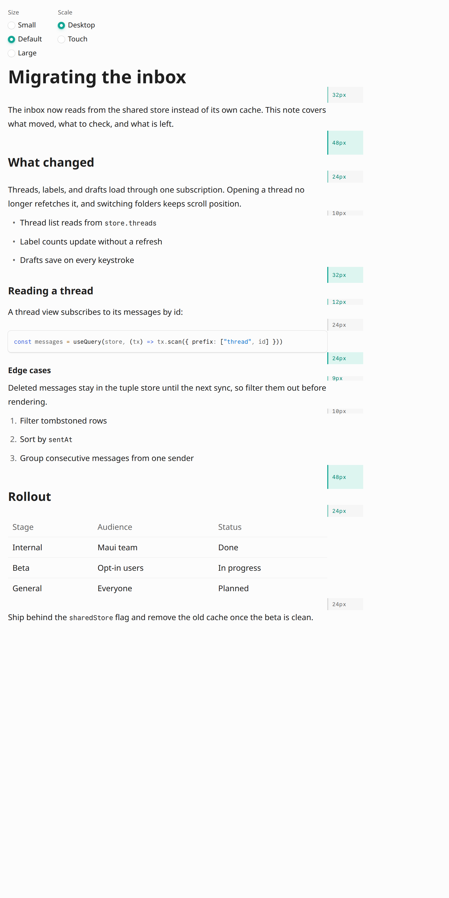
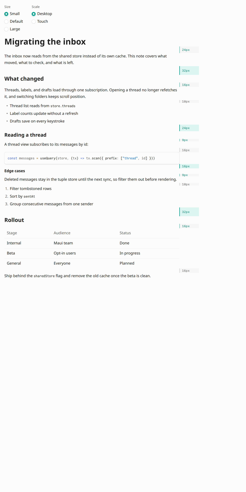
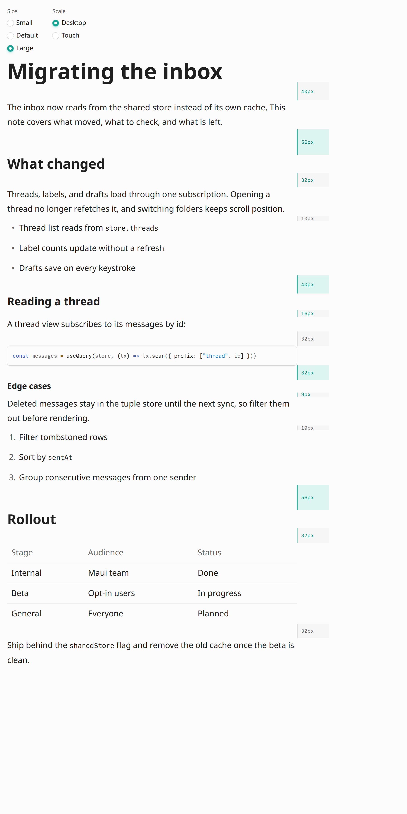
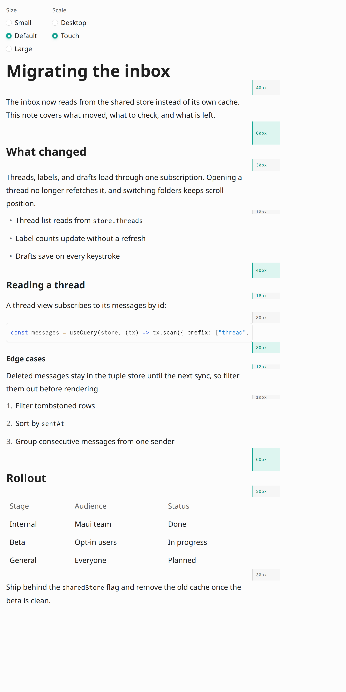
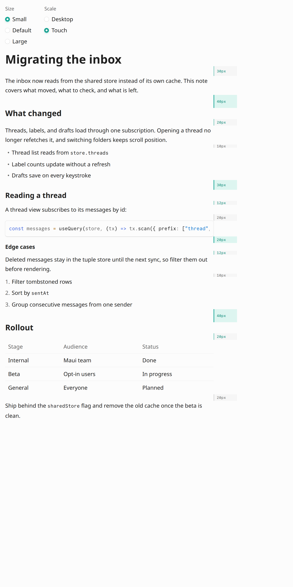
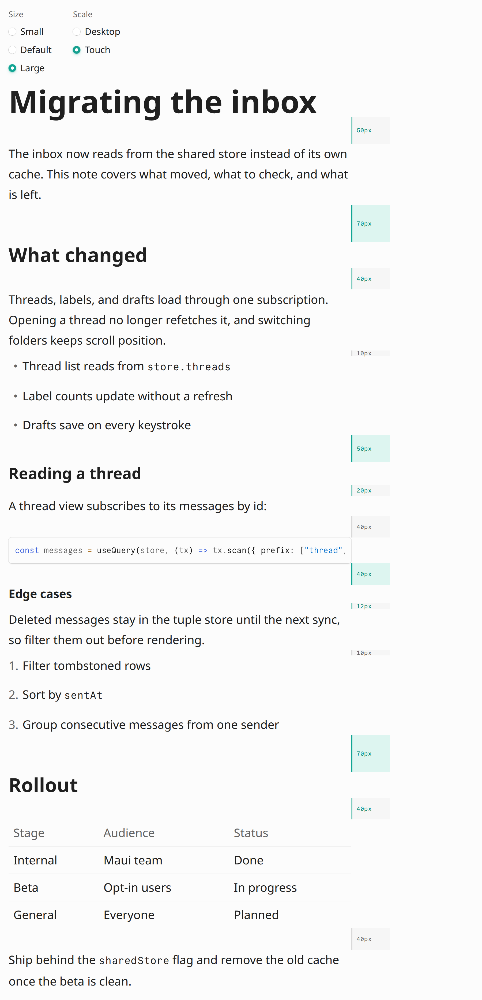
:::

**What the preview setup adds.** `src/previews.html` renders stories with product-doc's `PreviewRoute`. It ships to preview deployments only, with a `frame-ancestors` header that lets only diffmap.dev and the local viewer frame it. It runs on its own dev server, because a second entry under the gallery's bundled dev mode breaks the gallery's React Refresh. The stories need `@storybook/react` and `storybook` as dev dependencies. No Storybook server or config is added, but the lockfile grows by about 2,400 lines.

## Before and after

The "Long-form reply" panel on the gallery's Assistant message page renders the same Markdown in both captures. Before, every block is 10px apart. After, each `h2` sits 48px below the text above it and 24px above its own content. Paragraphs and lists stay 10px apart, and the code block and table get 24px.

:::gallery side-by-side
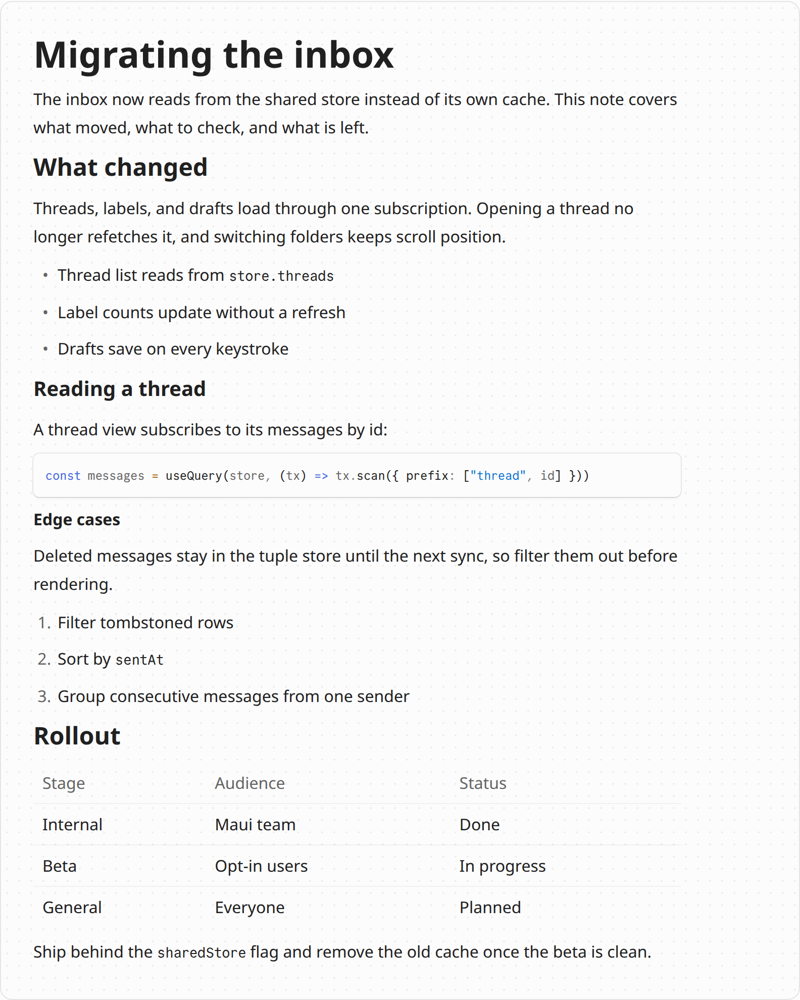
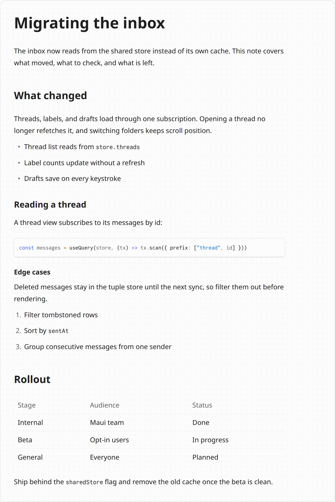
:::

:::gallery side-by-side
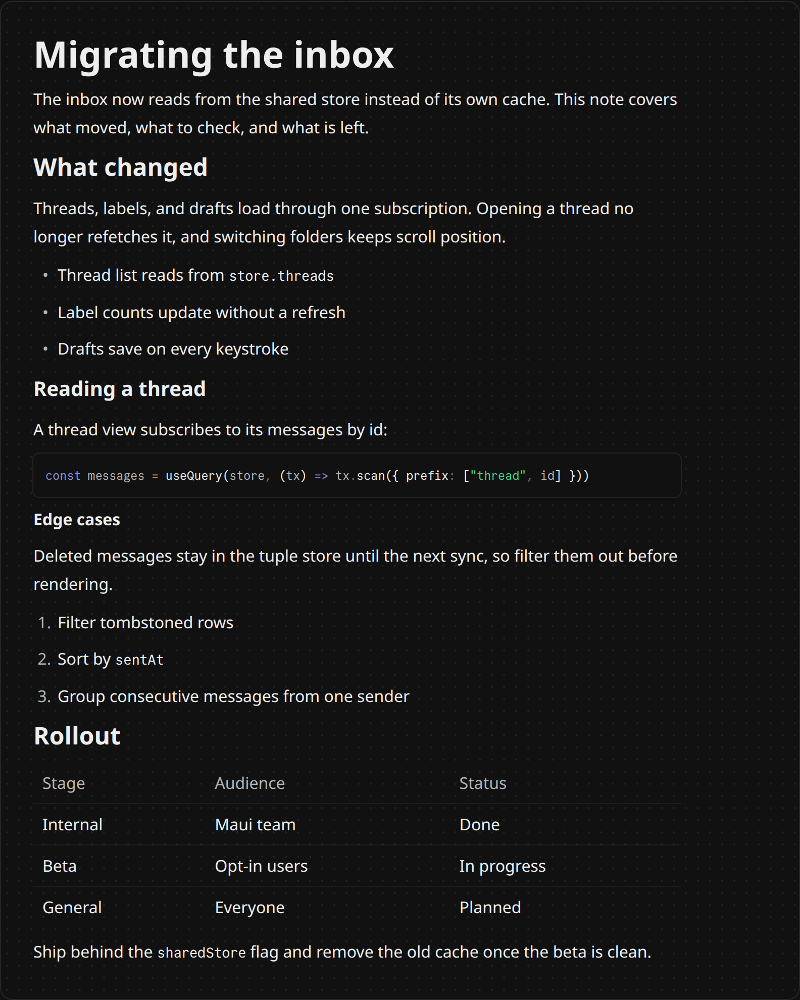
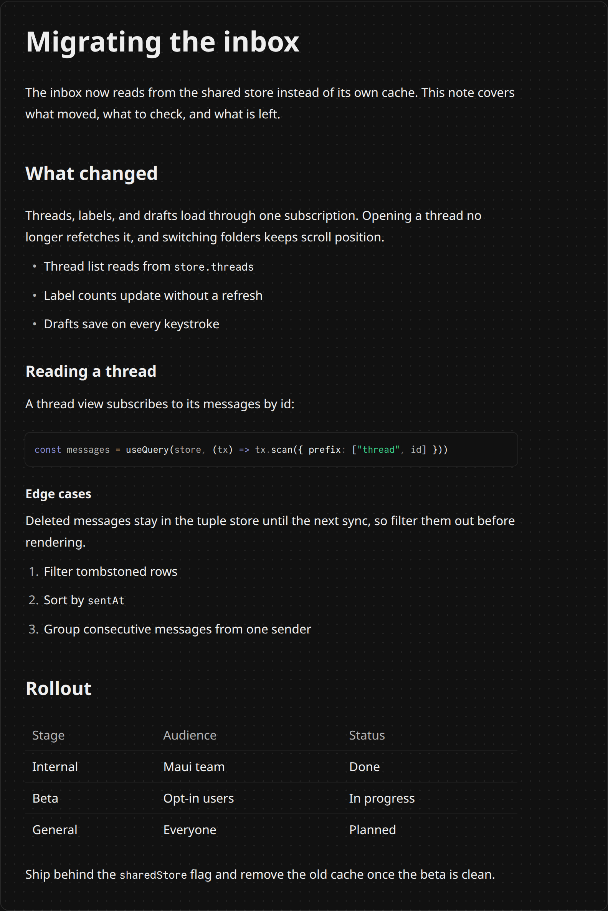
:::

The `Prose` component already had these heading gaps, and its paragraph gap does not change, so it looks the same. Its list items move from 8 to 9px apart:

:::gallery side-by-side
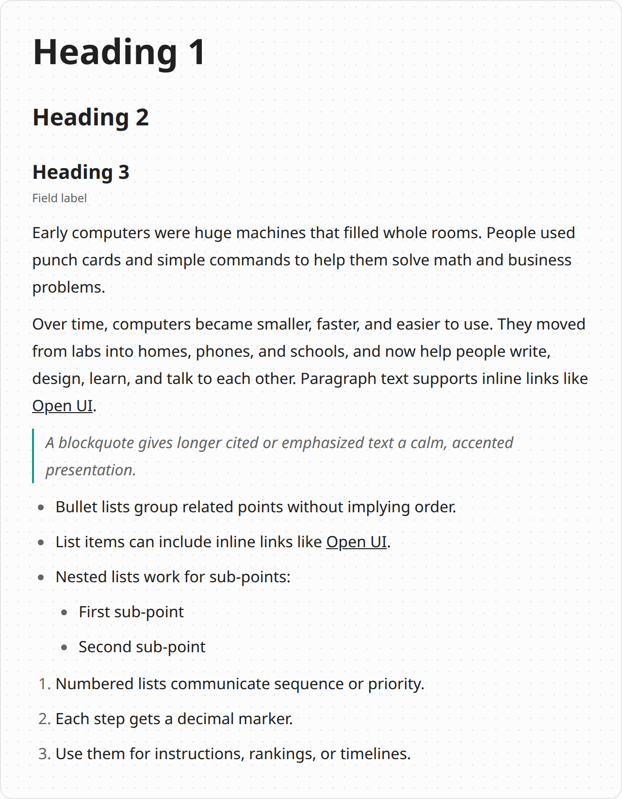

:::

## Implementation

The size table holds spacing tokens. `space` adds two steps when one is too small:

```ts [src/tokens/prose.ts]
const blockGap = "10px"

const space = (step: Space, ...more: Space[]) =>
	more.length === 0
		? spacing.value(step)
		: `calc(${[step, ...more].map((s) => spacing.value(s)).join(" + ")})`

md: {
	h2: { /* … */ marginTop: space(16, 8), marginBottom: space(12) },
	figureGap: space(12),
	ruleGap: space(16, 8),
	// …
}
```

`proseRhythm` puts the code block, table, and rule gaps before the heading rules. Wrapping the code block and table selector in `:where()` keeps its specificity at zero, so a heading directly above a code block still hugs it:

```ts {6-7}
return style({
	[`${selector} > * + *`]: { marginTop: blockGap },
	[`${selector} > * + ${figure}, ${selector} > ${figure} + *`]: { marginTop: m.figureGap },
	[`${selector} > * + hr, ${selector} > hr + *`]: { marginTop: m.ruleGap },
	[`${selector} > h2 + *`]: { marginTop: m.h2.marginBottom },
	[`${selector} > ${notHeading} + h2`]: { marginTop: m.h2.marginTop },
	// … h1, h3, h4
})
// [!note figure] `:where(pre, table, .maui-code-block, [data-streamdown="table-wrapper"], .tableWrapper)`
// [!note L6-L7] More specific than the figure rule, so heading gaps win.
```

## Verification

- In Chromium, the measured gaps in all six playground states match the tables above. In the TipTap editor, typed paragraphs sit 10px apart, and a new `h2` gets a 48px break and a 24px hug. The first heading of a streaming reply starts at 0.
- `npm run typecheck`, `npm test` (50 tests), `npm run build:lib`, and `npm run verify-package` pass.
- `vite build` emits `previews.html` without `VERCEL_ENV` set and leaves it out when `VERCEL_ENV=production`. The gallery dev server still loads normally.

## References

- Tailwind Typography v0.5.20, `src/styles.js` (`sm`, `base`, `lg`, and the `DEFAULT` table margins)
- [[c2fd65b:src/tokens/prose.ts]], [[src/tokens/spacing.ts]], [[c2fd65b:src/components/Editor.tsx]], [[src/patterns/AssistantMessage.tsx#AssistantMessage]], [[src/components/Prose.tsx#Prose]]
- Playground and stories: [[09011e9:src/pages/ProseSpacingPlayground.tsx]], [[09011e9:src/pages/ProseSpacing.stories.tsx]]

```changes
992466f..09011e9
src/tokens/prose.ts
src/components/Editor.tsx
src/patterns/AssistantMessage.tsx
src/pages/ProseSpacingPlayground.tsx
src/pages/ProseSpacing.stories.tsx
src/previews.tsx
src/previews.html
vite.config.ts
vercel.json
.diffmap/config.json
src/pages/AssistantMessagePage.tsx

ignore:
package.json
package-lock.json
.diffmap/specs/prose-heading-spacing/README.md
.diffmap/specs/prose-heading-spacing/media/markdown-reply-after-dark.png
.diffmap/specs/prose-heading-spacing/media/markdown-reply-after-light.png
.diffmap/specs/prose-heading-spacing/media/markdown-reply-before-dark.png
.diffmap/specs/prose-heading-spacing/media/markdown-reply-before-light.png
.diffmap/specs/prose-heading-spacing/media/prose-component-after-light.png
.diffmap/specs/prose-heading-spacing/media/prose-component-before-light.png
```
