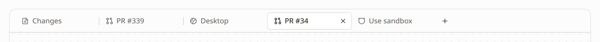
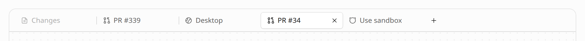
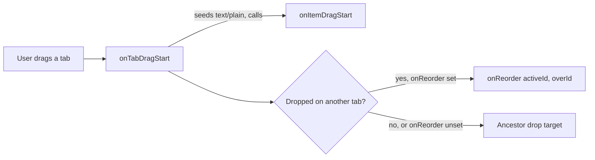
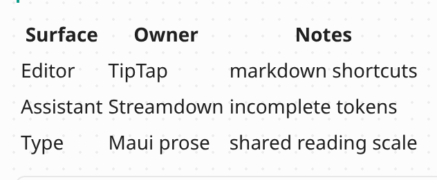
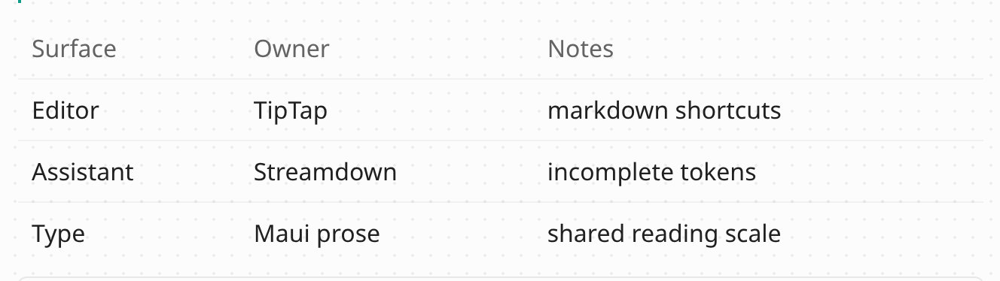

# ✅ Draggable workspace tabs and styled Markdown tables

Halo is moving its workspace tabs and its assistant transcript onto Maui. Two gaps blocked that: Maui's `TabBar` could not be dragged, and Markdown tables rendered through `proseHtml` had no styling at all. [PR #66](https://github.com/tanishqkancharla/maui/pull/66) closes both, rebased onto `main` at v0.0.74.

## Problem

**Tabs.** A Halo user rearranges tabs by dragging them, and drags a tab into another split pane to move it there. Maui's `TabBar` rendered plain tabs with no drag source and no drop handling, so adopting it would have removed both behaviors.

**Tables.** When an assistant reply or a TipTap document contained a Markdown table, `proseHtml` set only `margin: 0` on it. The browser defaults took over: no borders, bold centered headers, proportional digits, and a table that shrank to fit its content. Images could also push the reading column wider than its container.

## Solution

**Tabs.** A tab marked `isDraggable` becomes an HTML drag source and dims while dragged. The caller picks who handles the drop:

- Pass `onReorder(activeId, overId)` and the bar takes drops on its own tabs, so a user can reorder within the bar.
- Pass `onItemDragStart` / `onItemDragEnd` to put data on `dataTransfer` and let a drop target outside the bar handle it, as when Halo moves a tab into another pane.
- Pass both and a drop on a tab reorders, while a drop elsewhere goes to the caller's target.

In the gallery, the tab being dragged (here "Changes") fades to half opacity until the drop:

:::gallery carousel [Dragging a tab]


:::

Watch "Changes" move to fourth place when dropped on "PR #34", then return to first when dropped on "PR #339":




When the bar handles a drop it stops propagation, so a pane-level drop target above it does not also act on the same drop. When `onReorder` is unset, the bar never calls `preventDefault`, and drops bubble untouched to the caller.

```callstack [Reordering within the bar]
 onTabDragStart(item, event) [[96f6e90:src/components/TabBar.tsx#L224-L243]]
 ├── if target is inside [data-close-control]: cancel drag # closing a tab never starts a drag
 ├── draggingId = item.id # dims the tab via data-dragging
 ├── dataTransfer.setData("text/plain", item.id) # Firefox aborts drags with an empty store
 └── onItemDragStart?.(item.id, event)
 onTabDrop(over, event) [[96f6e90:src/components/TabBar.tsx#L267-L278]]
 ├── if onReorder unset or over is the dragged tab: return # let it bubble
 ├── event.stopPropagation()
 └── onReorder(draggingId, over.id)
```

The API, from the caller's side:

```tsx
<TabBar
  aria-label="Workspace tabs"
  items={tabs.map((tab) => ({ ...tab, isDraggable: true }))}
  selectedId={selectedId}
  onSelectionChange={setSelectedId}
  onReorder={(activeId, overId) => moveTab(activeId, overId)}
  onItemDragStart={(id, event) => event.dataTransfer.setData("application/x-halo-tab", id)}
/>
// [!note onReorder] Called with the dragged tab and the tab it was dropped on; the caller owns the new order.
// [!note onItemDragStart] Optional. Adds caller-owned drag data for drop targets outside the bar.
```

A tab is draggable when `isDraggable` is true. If `isDraggable` is left unset, a tab is draggable whenever `onItemDragStart` is passed ([[96f6e90:src/components/TabBar.tsx#L220-L222]]).

The gallery tab-bar page now reorders by drag; its `reorder` helper removes the dragged tab and inserts it at the drop target's original index, so swapping neighbours works in both directions ([[96f6e90:src/pages/TabBarPage.tsx#L72-L84]]).

**Tables and images.** `proseHtml` gives Markdown tables the same look as Maui's `Table` component ([[96f6e90:src/tokens/prose.ts#L347-L373]]):

```diff
 "& table": {
   margin: 0,
+  width: "100%",
+  borderCollapse: "collapse",
 },
+"& th, & td": {
+  ...block(m.paragraph),            // prose body size
+  padding: "6px 9px",
+  borderBottom: `1px solid ${borderColor.border}`,
+  fontVariantNumeric: "tabular-nums",
+},
+"& th": { fontWeight: 500, color: colors.gray[11] },
+"& tr:last-child td": { borderBottom: "none" },
+"& img": { maxWidth: "100%", height: "auto", borderRadius: "6px" },
```

The same Markdown table in the assistant-message sample, before and after. Today is captured from `main` with only this PR's sample table added, so the styling is the only difference. Look for the full-width layout, the hairline row borders, and the quieter left-aligned header:

:::gallery side-by-side


:::

Paragraphs and lists also get `minWidth: 0`, so an image inside them shrinks to the column instead of widening it. The assistant-message sample now includes a table so the gallery shows the result.

## Goals

- Halo can adopt `TabBar` without losing drag-to-reorder or drag-to-another-pane.
- Callers that pass no drag props see no change in behavior.
- Markdown tables in Streamdown and TipTap output look like Maui tables.

## Non-goals

- **Scrolling wide tables.** The change is CSS only and adds no wrapper element, so `proseHtml` cannot add a scroll container. Consumers wrap wide tables in an `overflow-x: auto` element; Halo plans to do this when it adopts the release.
- **Keyboard or touch reordering.** Drag uses the HTML drag-and-drop API, which needs a pointer. Arrow, Home/End, and Delete keys behave as before.
- **Drop position indicators.** A drop lands on the target tab's index; the bar draws no insertion line.

## Rebase onto v0.0.74

`main` had since moved TabBar's classes into an exported `tabBarStyles` object. The rebase keeps that refactor and adds the PR's drag state beside it; the only conflict was in the `useStyles` setup in `TabBar`. The `tabBarStyles` docs in the source and in `skills/maui/references/components/tab-bar.md` now mention the `data-dragging="true"` hook. No part of the PR had landed on `main` separately.

Checked after the rebase: `npm run typecheck`, `npm test` (50 tests), and `npm run build` pass. In headless Chromium, dragging the first gallery tab onto the third moved it to third place, and the recorded drags above ended in the expected order. A table cell in the assistant-message sample computed to `6px 9px` padding, a hairline bottom border, and `tabular-nums`.

```changes
96f6e90
src/components/TabBar.tsx
src/tokens/prose.ts
src/pages/TabBarPage.tsx
skills/maui/references/components/tab-bar.md
skills/maui/references/components/prose.md

ignore:
src/patterns/AssistantMessage.tsx
```

## References

- [PR #66](https://github.com/tanishqkancharla/maui/pull/66), branch `feat/tabbar-drag-prose-tables`
- [[96f6e90:src/components/TabBar.tsx]]: drag props and handlers
- [[96f6e90:src/tokens/prose.ts]]: `proseHtml` table and image rules
- [[96f6e90:skills/maui/references/components/tab-bar.md]], [[96f6e90:skills/maui/references/components/prose.md]]: consumer docs
